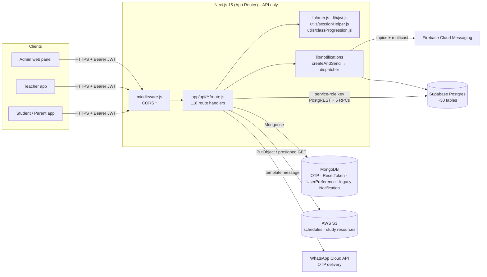
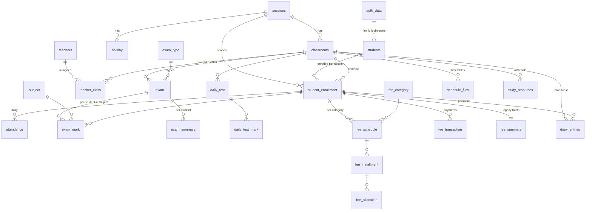
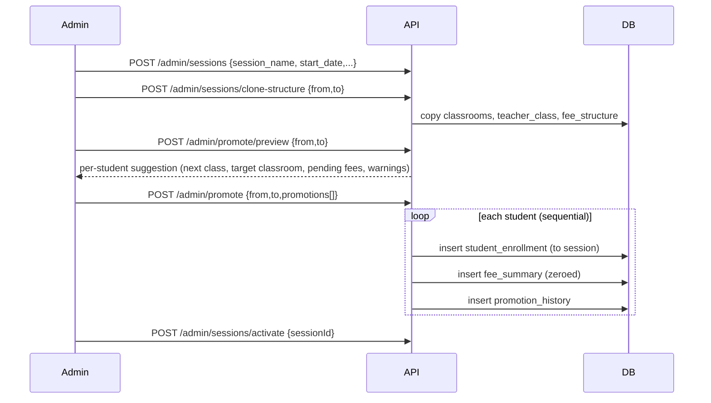
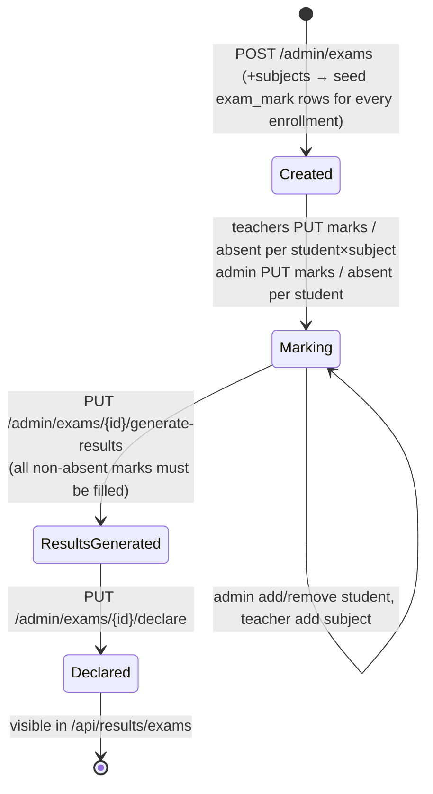
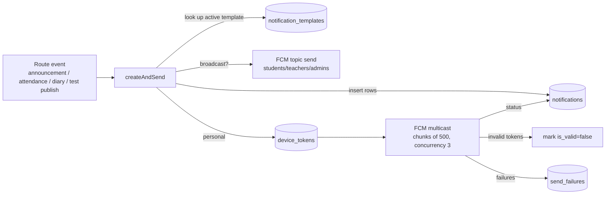

# VPS School ERP Backend: Feature & API Reference (As-Is)

| | |
|---|---|
| **Document** | 1 of 2. Feature and API reference |
| **Companion** | [02-system-analysis-and-loopholes.md](./02-system-analysis-and-loopholes.md) |
| **Codebase snapshot** | `main` @ `7a2bd0e` (118 route files, 139 HTTP operations, ~17k LOC) |
| **Reviewed** | 2026-10-29 |
| **Method** | Static reading of every file under `app/api`, `lib`, `utils`, `models`, `middleware.js` |

This document describes what the backend **currently does**, not what it should do. Where an endpoint has a
known defect, you'll see a marker like **⚠ SEC-03**. The ID points to the full write-up in the analysis document.

The database schema, RPC functions, triggers and generated columns live only in Supabase and are **not in
the repository**. Table and column names below were inferred from the queries in the code.

---

## Contents

1. [What the system is](#1-what-the-system-is)
2. [Architecture](#2-architecture)
3. [Actors and client applications](#3-actors-and-client-applications)
4. [Authentication and authorization model](#4-authentication-and-authorization-model)
5. [Domain model](#5-domain-model)
6. [Core feature modules](#6-core-feature-modules)
7. [Key business workflows](#7-key-business-workflows)
8. [API conventions as implemented](#8-api-conventions-as-implemented)
9. [Endpoint index (all 139 operations)](#9-endpoint-index-all-139-operations)
10. [Endpoint reference](#10-endpoint-reference)
11. [Data stores, RPCs and external services](#11-data-stores-rpcs-and-external-services)
12. [Configuration (environment variables)](#12-configuration-environment-variables)
13. [Legacy, dead and duplicate surface](#13-legacy-dead-and-duplicate-surface)

---

## 1. What the system is

A **school management ERP backend** for a single K-10 school (classes Nursery, LKG, UKG, 1–10, with English/Hindi
mediums). It is the server side for three clients:

- an **Admin web panel** (principal or office staff),
- a **Teacher mobile app**,
- a **Student/Parent mobile app** (one parent mobile number can hold several children).

The backend covers:

| Area | What it does today |
|---|---|
| Academic structure | Academic sessions (years), classrooms per session, subjects, exam types |
| Student information | Admission/registration, profile, status, parent login, enrollment per session, roll numbers |
| Staff | Teacher records and class assignments per session |
| Year rollover | Clone the class/teacher/fee structure into a new session, preview and execute promotions |
| Attendance | Daily attendance by teachers, monthly calendar and session summary for students, school dashboards |
| Examinations | Term exams with subjects, mark entry, absences, result generation (totals, grades, ranks), declaration |
| Class tests | Teacher-created daily tests, marks, publishing with per-student push notifications |
| Results | Student result cards, test history, performance analytics |
| Fees | Fee schedules per student, payment recording, fee lists, transaction ledger, student fee views |
| Communication | Announcements, class diary (personal and broadcast), push notifications (FCM), in-app inbox |
| Calendar | Holidays (and a read-only `events` table) |
| Timetables | Versioned daily and exam schedule files (PDF/images on S3) |
| Study resources | Teacher-uploaded learning material (versioned, S3) |
| Dashboards | Admin, teacher and student home dashboards |

**Not present**, although the README claims some of it: expense tracking, salary/payroll, financial reports, custom
reports, assignment submission, online payments, admissions CRM, transport, library, HR.

---

## 2. Architecture



| Layer | Implementation |
|---|---|
| Runtime | Next.js `15.1.11` route handlers. Likely deployed on Vercel (serverless functions). `app/page.js` is the unmodified create-next-app page, so there is no UI in this repo. |
| HTTP middleware | `middleware.js`: adds `Access-Control-Allow-Origin: *` to `/api/*` and answers `OPTIONS`. Nothing else (no auth, no rate limiting, no logging). |
| Auth | `lib/jwt.js` (HS256, `JWT_SECRET`, default expiry **90 days**). `lib/auth.js` provides `authenticateUser` (any valid token) and `authenticateAdmin` (`role === 'admin'`). |
| Primary DB | Supabase Postgres, accessed only through `@supabase/supabase-js` with the **service-role key** (bypasses Row Level Security). |
| Secondary DB | MongoDB via Mongoose: password-reset OTPs, reset tokens, user preferences, and a legacy notification collection. |
| Files | AWS S3: schedule files and study resources. Uploads stream through the API function. Downloads use presigned GET URLs. |
| Push | Firebase Admin SDK: topic sends (`students`, `teachers`, `admins`) and per-device multicast. Invalid tokens are cleaned up automatically. |
| OTP | Meta WhatsApp Cloud API (Graph v21.0), template `otp_verification`, assumes the `+91` country code. |
| Validation | Hand-written checks in most routes. `zod` is used only in the admin teacher routes. |
| Shared helpers | `utils/sessionHelper.js` (active-session resolution) and `utils/classProgression.js` (class ladder). |

There is no service layer, repository layer, queue, cache, or background worker. Each route handler does
authentication, validation, business logic, data access and response formatting inline.

---

## 3. Actors and client applications

| Actor | Client | Identity store | Login identifier | Token issued by |
|---|---|---|---|---|
| **Admin** | Web panel | `admin_users` table | mobile + password | `POST /api/admin/login` (or the public `POST /api/admin/register`, **⚠ SEC-01**) |
| **Teacher** | Mobile app | `teachers` table (`password` column) | numeric `teacher_id` + password | `POST /api/auth/teacher/login` |
| **Parent / Student** | Mobile app | `auth_data` table (one row per **family mobile number**) → many `students` | mobile + password | `POST /api/auth/login` (returns **one token per child**) |

The parent login is family-scoped. A single mobile/password (`auth_data`) owns every sibling's `students` row. Login
returns a list of child profiles, each with its own JWT. Changing the password from any child changes it for the
whole family.

---

## 4. Authentication and authorization model

### 4.1 Token claims

| Token | Claims | Role marker |
|---|---|---|
| Student (per child) | `authId, studentId, enrollmentId, classId, sessionId, name` | **none.** A student is recognised by the presence of `studentId`. |
| Teacher | `teacherId, name, email, role: 'teacher'` | `role` |
| Admin | `id, mobile, role: 'admin', name` | `role` |

All tokens are HS256 JWTs with the same secret and a 90-day lifetime. There is no refresh token, logout, revocation
list, or token versioning. A student token's `enrollmentId`, `classId` and `sessionId` are fixed at login time
(**⚠ SEC-11, DAT-18**).

Clients send `Authorization: Bearer <jwt>`.

### 4.2 Guards actually used

| Guard | Where | What it checks |
|---|---|---|
| `authenticateAdmin` | 38 admin route files | Valid JWT **and** `role === 'admin'`. It does not re-check `admin_users.is_active`. |
| `authenticateUser` | Student, teacher, shared routes, **and some admin routes** | Only that the JWT is valid. Any role passes. |
| Inline `auth.user.role !== 'teacher'` | Most teacher routes | Teacher role. **Missing** on the diary routes (**⚠ SEC-08**). |
| Inline `!auth.user.studentId` | Student resource routes | Student token. |
| Inline teacher↔class check (`teacher_class`) | Teacher result/test routes | Only for results and tests. **Missing** for attendance, student list, diary and resources (**⚠ SEC-09**). |
| **None** | 13 route files | `metadata/*`, `admin/register`, `admin/login`, `auth/*`, `notifications/event`, `devices`, `student/notification`, `teacher/dairy/addnote` |

---

## 5. Domain model

### 5.1 Entity relationships (inferred)



### 5.2 Core concepts

| Concept | Table(s) | Meaning |
|---|---|---|
| **Session** | `sessions` | An academic year (for example `2025-26`). Exactly one should have `is_active = true`. If none does, code falls back to the latest `start_date`. |
| **Classroom** | `classrooms` | A *(session, class, section, medium)* tuple, for example 2025-26 / 10 / A / English. Classrooms are re-created every session. |
| **Student** | `students` | The person (demographics, status). Linked to a family login through `auth_id`. |
| **Enrollment** | `student_enrollment` | A student in a classroom for a session, with a roll number. **Attendance, marks, diary and fees all key on `enrollment_id`.** |
| **Teacher assignment** | `teacher_class` | Teacher ↔ classroom, optionally temporary (`valid_upto`) with a free-text `schedule`. |
| **Exam** | `exam`, `exam_mark`, `exam_summary` | An exam belongs to one classroom. Its subjects exist only as `exam_mark` rows (one per student × subject, each carrying `max_marks`). `exam_summary` holds the computed totals, grade and rank. `is_declared` publishes the exam to students. |
| **Daily test** | `daily_test`, `daily_test_mark` | A single-subject class test. `is_declared` publishes it. |
| **Fee (new model)** | `fee_category`, `fee_structure`, `fee_schedule`, `fee_installment`, `fee_transaction`, `fee_allocation` | A schedule is a category amount per enrollment, split into installments. Transactions are payments, and allocations map payments to installments. Used by the admin panel. |
| **Fee (legacy model)** | `fee_summary` | Flat totals per enrollment (`school_fees`, `bus_fees`, `other_fees`, `discount`, `paid_fees`, `due`). Used by the student fee summary and by promotion (**⚠ DAT-03**). |
| **Notification** | `notifications`, `notification_templates`, `device_tokens`, `send_failures` | Audit and inbox rows plus FCM delivery. Broadcasts store a single row with `recipient_id = 'ALL'`. |

### 5.3 Status vocabularies in use

| Field | Values found in code |
|---|---|
| `students.status` | `Active`, `Paused`, `Leave` (status API). `Passed Out`, `Left` (promotion). Error text also lists `Inactive, Graduated, Transferred, Dropped` (**⚠ DAT-15**). |
| `attendance.status` | `Present`, `Absent`, `Leave` |
| `diary_entries.entry_type` | `Personal`, `Broadcast` |
| `announcements.type` | `event`, `notice`, `reminder`, `news`, `calendar` (shown to clients as `Information` for `notice` in one route) |
| `announcements.priority` | `high`, `medium`, `low` (stored lowercase; validated as `High/Medium/Low`) |
| `study_resources.resource_type` | `notes`, `assignment`, `reference`, `video`, `presentation`, `other` |
| `schedule_files.type` | `daily`, `exam` |
| `promotion status` | `promoted`, `detained`, `passed_out`, `transferred` |

---

## 6. Core feature modules

| # | Module | Purpose | Main endpoints |
|---|---|---|---|
| F1 | **Identity & access** | Logins for 3 actor types, WhatsApp OTP password reset, password change, user settings | `/api/auth/*`, `/api/admin/login`, `/api/admin/register`, `/api/users/*`, `/api/teacher/profile/change-password` |
| F2 | **Academic sessions & rollover** | Create and activate years, clone structure, promotion preview and execution | `/api/admin/sessions*`, `/api/admin/promote*` |
| F3 | **Master data** | Classrooms, subjects, exam types | `/api/admin/classes`, `/api/admin/subjects`, `/api/admin/exam-types`, `/api/metadata/*`, `/api/teacher/subjects` |
| F4 | **Student information system** | Register, search, view, edit and delete students, status, login mobile and password | `/api/admin/students*`, `/api/users/profile` |
| F5 | **Teacher management** | Teacher CRUD, class assignments per session, teacher profile | `/api/admin/teachers*`, `/api/teacher/profile`, `/api/teacher/classlist`, `/api/teacher/dashboard` |
| F6 | **Attendance** | Mark daily attendance, student calendar and summary, school-level analytics | `POST /api/teacher/attendance`, `GET /api/attendance`, `/api/admin/dashboard` |
| F7 | **Examinations** | Exam CRUD, subject seeding, roster changes, marks and absences, result generation, declaration | `/api/admin/exams*`, `/api/teacher/result/exams*` |
| F8 | **Class tests** | Create tests, enter marks, rank, publish with push | `/api/teacher/result/tests*` |
| F9 | **Student results & analytics** | Result list and detail, test history, performance trend | `/api/results/*` |
| F10 | **Fees & payments** | Fee schedules, payments, lists and ledger, student fee views | `/api/admin/fees*`, `/api/admin/transactions`, `/api/student/fees/*` |
| F11 | **Communication** | Announcements, diary, push notifications, inbox, device registration | `/api/admin/announcements*`, `/api/announcements`, `/api/admin/diary-notes`, `/api/teacher/diary/*`, `/api/diary`, `/api/notifications*`, `/api/devices` |
| F12 | **Calendar** | Holidays (and read-only events on the student dashboard) | `/api/admin/holidays`, `/api/dashboard` |
| F13 | **Timetables / schedules** | Versioned daily and exam timetable files | `/api/admin/schedules*`, `/api/student/schedules/*` |
| F14 | **Study resources** | Versioned teaching material per class and subject | `/api/teacher/resources*`, `/api/student/resources*`, `/api/admin/resources*` |
| F15 | **Dashboards** | Role home screens | `/api/admin/dashboard`, `/api/teacher/dashboard`, `/api/dashboard` |

---

## 7. Key business workflows

### W1. Parent login and child selection

1. `POST /api/auth/login {mobile, password}` checks the `auth_data` row with bcrypt.
2. The server loads every `students` row for that `auth_id`, resolves the active session, and loads all enrollments.
3. For each child, it picks the active-session enrollment, or else the latest one.
4. Active children with an enrollment get `access: 'full'` and a JWT carrying `enrollmentId/classId/sessionId`.
   Others get `access: 'restricted'` and a message, with no token.
5. The app stores the chosen child's token. All student endpoints then read the enrollment and class **from the token**.

### W2. Password reset via WhatsApp OTP

1. `POST /api/auth/forgot-password {mobile}` deletes earlier unused OTPs, generates a 6-digit code, stores its bcrypt
   hash in Mongo (10 min TTL) and sends it with the WhatsApp template. The response contains a masked mobile number.
2. `POST /api/auth/verify-otp {mobile, otp}` checks the code, deletes the OTP and returns a `resetToken` (random 32 bytes, 30 min).
3. `POST /api/auth/reset-password {resetToken, newPassword}` updates `auth_data.password` and deletes the token.
4. `POST /api/auth/resend-otp` repeats step 1.
5. This flow covers **parents only**. Teachers and admins have no reset flow.

### W3. Academic year rollover



- Promotion statuses: `promoted` and `detained` create a new enrollment. `passed_out` sets the student status to `Passed Out`. `transferred` sets it to `Left`.
- Class progression follows the fixed ladder `Nursery → LKG → UKG → 1 … 10`. Class 10 becomes "passed out".
- Students must log in again after rollover, because tokens still carry the old enrollment.

### W4. Exam lifecycle



- Generating results computes the total, maximum, percentage, grade and rank per enrollment. Present students are
  ranked by percentage first, then absent students after them. Results are upserted into `exam_summary`.
- After declaration, teacher mark edits are blocked. Admin mark edits are **not** blocked (**⚠ DAT-08**).

### W5. Class test lifecycle

`POST /teacher/result/tests` creates the test. Teachers then `PUT /teacher/result/tests/{id}/students/{sid}` to upsert
marks or absence, and `PUT /teacher/result/tests/{id}/publish` sets `is_declared` and pushes each student's score.
`GET /teacher/result/tests/{id}/rank` gives dense ranks.

### W6. Attendance

The teacher calls `POST /teacher/attendance {classroomId, date, records[]}`. The server inserts the rows and, without
waiting, sends one push per student ("marked Present/Absent/Leave"). Students read
`GET /attendance?year&month`, which returns a day-by-day calendar (Sundays and `holiday` rows count as holidays)
and a session-wide percentage (present ÷ (present + absent + leave)).

### W7. Fees

The admin creates a fee schedule per student and category (`POST /admin/fees/{studentId}/fees`), records payments
(`POST /admin/fees/{studentId}/transactions`), and reviews the class fee list (`GET /admin/fees`) and ledger
(`GET /admin/transactions`). "Paid" amounts in the admin views are computed from `fee_allocation`. Nothing in the
code creates allocation or installment rows, so this presumably happens in database triggers that aren't in the
repo (**⚠ DAT-04**). The student app reads the legacy `fee_summary` totals and the installment-based pending list.

### W8. Notifications



- The driver is selected by `NOTIFICATION_DRIVER`. Only `sync` works. `queue` throws "not implemented".
- Devices register through `POST /api/devices {token, platform, role, userId}`, which also subscribes the device to
  the `<role>s` topic.
- The in-app inbox is `GET /api/notifications`, plus the unread-count and mark-read endpoints.
- Events that trigger pushes: announcement creation (everyone), attendance (per student), diary entry (per student
  or the whole class), test publish (per student). Exam declaration does **not** send a push. Resource upload push is
  commented out.

### W9. Versioned file publishing (schedules and resources)

Uploads go through the API as multipart form data. The server writes them to S3 under a versioned key
(`daily-schedule/{year}/{classroom}/v{n}.pdf`, `exam-schedule/{year}/{classroom}/{exam}/v{n}.pdf`,
`study-resources/{year}/{classroom}/{subject}/{type}/v{n}/{file}`), inserts a row with `is_current = true`, and sets
earlier versions to `is_current = false`. Readers get short-lived presigned URLs: 5 min for students, 24 h for the
daily schedule, 1 h for admin resources, 5 h for admin schedules.

---

## 8. API conventions as implemented

### 8.1 Response envelopes

There is no single envelope. The main shapes in use:

| # | Shape | Used by |
|---|---|---|
| E1 | `{ status: 'success'\|'error', message, data? }` | `/api/auth/login`, forgot/resend/verify/reset password |
| E2 | `{ success, data: { message }, status }` (status code repeated in the body) | `/api/auth/teacher/login` |
| E3 | `{ message, token, user }` / `{ error }` | `/api/admin/login`, `/api/admin/register`, admin students POST, holidays errors |
| E4 | `{ success, data, timestamp }` / `{ success:false, error:{code,message,fields?}, timestamp }` | admin classes, teachers, subjects, exams, exam-types |
| E5 | `{ success, data, message? }` / `{ success:false, message }` | most teacher, student and shared routes |
| E6 | Bare objects, no `success` (e.g. `{ totalFee, schoolFee, … }`, `{ totalTransactions, transactions }`) | `/api/student/fees/summary`, `/api/student/fees/transactions` |
| E7 | Top-level arrays and keys (`{ success, announcements, diaryEntries, attendance, events }`, `{ success, entries }`, `{ success, profile }`, `{ success, holidays, pagination }`) | `/api/dashboard`, `/api/diary`, `/api/users/profile`, `/api/admin/holidays` |

### 8.2 Pagination styles

| Style | Params | Response meta | Used by |
|---|---|---|---|
| Page/limit | `page`, `limit` | `{ total, pages, page, limit, hasNext, hasPrev }` | admin students, teachers, fees, transactions, diary-notes, announcements |
| Page/limit (alt meta) | `page`, `limit` | `{ currentPage, totalPages, totalItems, itemsPerPage, hasNextPage, hasPrevPage }` | admin exams |
| Page/limit (alt meta 2) | `page`, `limit` | `{ page, limit, total, totalPages }` | admin holidays, resources (all 3 roles) |
| Page/pageSize | `page`, `pageSize` | `{ totalItems, itemsPerPage, currentPage, totalPages, hasNextPage, hasPreviousPage }` | `/api/announcements` |
| Offset/limit | `offset`, `limit` | `{ total, items, limit, offset }` or `{ total, limit, offset, hasMore }` | teacher result exams/tests, student results, fee info |

Default page sizes are 10, 20 or 50 depending on the route. Only a few routes cap `limit` at 100.

### 8.3 Identifier and parameter naming

Parameters mix `snake_case` and `camelCase` for the same concept: `session_id`/`sessionId`,
`classroom_id`/`classroomId`/`classId`/`class_id`, `exam_id`/`examId`. IDs are sequential integers. Dates are
`YYYY-MM-DD` strings. `diary_entries.created_at` holds a date, not a timestamp.

---

## 9. Endpoint index (all 139 operations)

Auth legend: **P** = public (no auth) · **U** = any valid JWT · **S** = student token · **T** = teacher token ·
**A** = admin token. ⚠ = has a security or correctness issue (see doc 2).

### 9.1 Public / identity

| Method | Path | Auth | Purpose |
|---|---|---|---|
| POST | `/api/auth/login` | P | Parent login → child profiles + tokens |
| POST | `/api/auth/teacher/login` | P | Teacher login |
| POST | `/api/admin/login` | P | Admin login |
| POST | `/api/admin/register` | **P ⚠** | Create an admin account (**unauthenticated**) |
| POST | `/api/auth/forgot-password` | P ⚠ | Send password-reset OTP over WhatsApp |
| POST | `/api/auth/resend-otp` | P ⚠ | Resend OTP |
| POST | `/api/auth/verify-otp` | P ⚠ | Verify OTP → reset token |
| POST | `/api/auth/reset-password` | P | Set new password with reset token |
| GET | `/api/metadata/subjects` | P | Subject names |
| GET | `/api/metadata/exam-types` | P | Exam type names |

### 9.2 Student / parent app

| Method | Path | Auth | Purpose |
|---|---|---|---|
| GET | `/api/dashboard` | S | Home: 3 announcements, 3 diary entries, attendance totals, 3 events |
| GET | `/api/users/profile` | S | Student profile (personal, contact, academic) |
| POST | `/api/users/change-password` | S ⚠ | Change the family login password (no current-password check) |
| GET | `/api/users/settings` | S | Notification and dark-mode preferences (Mongo) |
| PUT | `/api/users/settings` | S | Update preferences |
| GET | `/api/attendance` | U ⚠ | Monthly attendance calendar + session summary |
| GET | `/api/diary` | S | Personal and class diary entries |
| GET | `/api/announcements` | U | Announcements list (includes inactive) |
| GET | `/api/results/exams` | S | Declared exam results for a session |
| GET | `/api/results/exams/{examId}` | S ⚠ | Subject-wise result for one exam (no declaration check) |
| GET | `/api/results/tests` | S ⚠ | Class test results (no publish check) |
| GET | `/api/results/performance` | S ⚠ | Overall %, last rank, subject averages, trend |
| GET | `/api/student/fees/summary` | U ⚠ | Fee totals and dues (legacy model; `?studentId` override) |
| GET | `/api/student/fees/info` | U ⚠ | Pending and overdue installments (`?studentId` override) |
| GET | `/api/student/fees/transactions` | U ⚠ | Payment history (`?studentId` override) |
| GET | `/api/student/schedules/daily` | S | Current daily timetable file URL |
| GET | `/api/student/schedules/exam/terms` | S | Exams that have a timetable |
| GET | `/api/student/schedules/exam` | S | Exam timetable file URL |
| GET | `/api/student/resources` | S | Study resources for the student's class |
| GET | `/api/student/resources/{id}` | S | Resource download URL |
| GET | `/api/student/notification` | **P ⚠** | Legacy Mongo notifications by `student_id` |

### 9.3 Teacher app

| Method | Path | Auth | Purpose |
|---|---|---|---|
| GET | `/api/teacher/dashboard` | T | Assigned classes and counts |
| GET | `/api/teacher/classlist` | T | Assigned classes (active or inactive) |
| GET | `/api/teacher/studentslist` | T ⚠ | Students in a classroom (no assignment check) |
| GET | `/api/teacher/profile` | T | Own profile |
| PUT | `/api/teacher/profile` | T ⚠ | Update own profile (mass assignment) |
| POST | `/api/teacher/profile/change-password` | T ⚠ | Change password (no current-password check) |
| GET | `/api/teacher/subjects` | T | All subjects |
| POST | `/api/teacher/attendance` | T ⚠ | Mark attendance (no assignment check, insert-only) |
| POST | `/api/teacher/diary/addnote` | **U ⚠** | Add a diary entry and push it |
| GET | `/api/teacher/diary/allnotes` | U ⚠ | Own diary entries |
| DELETE | `/api/teacher/diary/deletenote` | U | Delete own diary entry |
| POST | `/api/teacher/dairy/addnote` | **P ⚠** | Legacy Mongo "diary note" (typo path, no auth) |
| GET | `/api/teacher/resources` | T | Own study resources |
| POST | `/api/teacher/resources` | T ⚠ | Upload a resource (no assignment check, no size or type limit) |
| GET | `/api/teacher/resources/{id}` | T | Own resource + URL |
| PUT | `/api/teacher/resources/{id}` | T | Update metadata or upload a new version |
| DELETE | `/api/teacher/resources/{id}` | T | Delete resource and S3 object |
| GET | `/api/teacher/result/exams` | T | Exams of an assigned class |
| GET | `/api/teacher/result/exams/{examId}/subjects` | T | Subjects and marking progress |
| POST | `/api/teacher/result/exams/{examId}/subjects` | T | Add a subject to an exam (seeds blank marks) |
| GET | `/api/teacher/result/exams/{examId}/subjects/{subjectId}/students` | T | Marks list for a subject |
| PUT | `/api/teacher/result/exams/{examId}/subjects/{subjectId}/students/{studentId}` | T | Enter marks or absence |
| PUT | `/api/teacher/result/exams/{examId}/subjects/{subjectId}/publish` | T ⚠ | "Publish" a subject (validation only, nothing stored) |
| GET | `/api/teacher/result/exams/{examId}/rank` | T | Exam rank list |
| GET | `/api/teacher/result/tests` | T | Own tests for a class |
| POST | `/api/teacher/result/tests` | T | Create test |
| GET | `/api/teacher/result/tests/{testId}/students` | T | Class roster with marks |
| PUT | `/api/teacher/result/tests/{testId}/students/{studentId}` | T ⚠ | Upsert marks (allowed after publish) |
| PUT | `/api/teacher/result/tests/{testId}/publish` | T | Publish + push scores |
| GET | `/api/teacher/result/tests/{testId}/rank` | T | Dense rank list |

### 9.4 Admin panel

| Method | Path | Auth | Purpose |
|---|---|---|---|
| GET | `/api/admin/dashboard` | A ⚠ | School KPIs (some values wrong or hard-coded) |
| GET | `/api/admin/sessions` | A | List sessions |
| POST | `/api/admin/sessions` | A | Create session |
| PUT | `/api/admin/sessions` | A | Update session |
| POST | `/api/admin/sessions/activate` | A ⚠ | Set active session (non-atomic) |
| POST | `/api/admin/sessions/clone-structure` | A ⚠ | Clone classrooms, assignments, fee structure |
| POST | `/api/admin/promote/preview` | A | Dry-run promotion |
| POST | `/api/admin/promote` | A ⚠ | Execute promotions |
| GET | `/api/admin/classes` | A | List classrooms |
| POST | `/api/admin/classes` | A | Create classroom |
| PUT | `/api/admin/classes` | A | Update classroom |
| DELETE | `/api/admin/classes` | A | Delete classroom |
| GET | `/api/admin/subjects` | A | List subjects |
| POST | `/api/admin/subjects` | A | Create subject |
| GET | `/api/admin/exam-types` | A | List exam types |
| GET | `/api/admin/students` | A ⚠ | Search and list students |
| POST | `/api/admin/students` | A | Register student (RPC) |
| GET | `/api/admin/students/{studentId}` | A | Student detail + 30-day attendance |
| PUT | `/api/admin/students/{studentId}` | A ⚠ | Update student / move classroom |
| DELETE | `/api/admin/students/{studentId}` | A ⚠ | Hard-delete student |
| PUT | `/api/admin/students/{studentId}/status` | A | Change status |
| PUT | `/api/admin/students/{studentId}/updatemobile` | A ⚠ | Change login mobile (re-links family) |
| PUT | `/api/admin/students/{studentId}/updatepassword` | A | Reset family password |
| GET | `/api/admin/teachers` | A ⚠ | List teachers (includes password hash) |
| POST | `/api/admin/teachers` | A | Create teacher |
| GET | `/api/admin/teachers/{id}` | A ⚠ | Teacher + session assignments (includes password hash) |
| PUT | `/api/admin/teachers/{id}` | A | Update teacher |
| DELETE | `/api/admin/teachers/{id}` | A | Delete teacher (only if no assignments) |
| POST | `/api/admin/teachers/{id}/classes` | A | Assign classes |
| DELETE | `/api/admin/teachers/{id}/classes` | A | Remove assignments (JSON body) |
| GET | `/api/admin/exams` | A | List exams |
| POST | `/api/admin/exams` | A ⚠ | Create exam + seed marks |
| GET | `/api/admin/exams/{examId}` | A | Exam detail, results, statistics |
| PUT | `/api/admin/exams/{examId}` | A | Update exam |
| DELETE | `/api/admin/exams/{examId}` | A ⚠ | Delete exam (summary guard broken) |
| GET | `/api/admin/exams/{examId}/students` | A | Enrolled students not yet in the exam |
| POST | `/api/admin/exams/{examId}/students` | A | Add student to exam |
| DELETE | `/api/admin/exams/{examId}/students/{studentId}` | A | Remove student from exam |
| PUT | `/api/admin/exams/{examId}/students/{studentId}/marks` | A ⚠ | Edit marks (allowed after declaration) |
| PUT | `/api/admin/exams/{examId}/students/{studentId}/absent` | A ⚠ | Mark absent (guard broken) |
| PUT | `/api/admin/exams/{examId}/generate-results` | A | Compute summaries and ranks |
| PUT | `/api/admin/exams/{examId}/declare` | A | Declare results |
| GET | `/api/admin/fees` | A ⚠ | Class fee status list (in-memory pagination) |
| GET | `/api/admin/fees/filter-options` | A | Classes, payment modes, fee categories |
| GET | `/api/admin/fees/{studentId}` | A ⚠ | Student fee detail (fails after promotion) |
| POST | `/api/admin/fees/{studentId}/fees` | A | Add fee schedule |
| PUT | `/api/admin/fees/{studentId}/fees/{feeId}` | A ⚠ | Update fee schedule (`dueDate` ignored) |
| DELETE | `/api/admin/fees/{studentId}/fees/{feeId}` | A | Delete fee schedule |
| POST | `/api/admin/fees/{studentId}/transactions` | A ⚠ | Record payment (not idempotent) |
| DELETE | `/api/admin/fees/{studentId}/transactions/{transactionId}` | A ⚠ | Hard-delete payment |
| GET | `/api/admin/transactions` | A ⚠ | Payment ledger (filters applied after pagination) |
| GET | `/api/admin/announcements` | **U ⚠** | List announcements |
| POST | `/api/admin/announcements` | **U ⚠** | Create announcement + push to everyone |
| GET | `/api/admin/announcements/{id}` | **U ⚠** | Get announcement |
| PUT | `/api/admin/announcements/{id}` | **U ⚠** | Update announcement |
| DELETE | `/api/admin/announcements/{id}` | **U ⚠** | Delete announcement |
| GET | `/api/admin/diary-notes` | **U ⚠** | All diary entries in the school |
| POST | `/api/admin/diary-notes` | **U ⚠** | Create diary entry for any class or student |
| GET | `/api/admin/holidays` | A | List holidays |
| POST | `/api/admin/holidays` | A | Create holiday |
| PUT | `/api/admin/holidays` | A | Update holiday |
| DELETE | `/api/admin/holidays` | A | Delete holiday |
| GET | `/api/admin/schedules` | A | List current schedule files |
| POST | `/api/admin/schedules` | A | Upload schedule file (new version) |
| PUT | `/api/admin/schedules` | A | Update schedule metadata or file |
| DELETE | `/api/admin/schedules` | A | Delete schedule row |
| GET | `/api/admin/schedules/{scheduleId}/view` | A | 5-hour presigned URL |
| HEAD | `/api/admin/schedules/{scheduleId}/view` | A | Schedule metadata check |
| GET | `/api/admin/resources` | A | List all current resources |
| GET | `/api/admin/resources/{id}` | A | 1-hour presigned URL |
| DELETE | `/api/admin/resources/{id}` | A | Delete resource |

### 9.5 Shared / infrastructure

| Method | Path | Auth | Purpose |
|---|---|---|---|
| GET | `/api/notifications` | U | Inbox (personal + broadcast) |
| GET | `/api/notifications/unread-count` | U | Unread count |
| PATCH | `/api/notifications/{id}/read` | U | Mark one as read |
| PATCH | `/api/notifications/read-all` | U | Mark all personal as read |
| POST | `/api/notifications/event` | **P ⚠** | Send arbitrary notifications to anyone (**no auth**) |
| POST | `/api/devices` | **P ⚠** | Register an FCM token for any role or user (**no auth**) |
| DELETE | `/api/devices` | **P ⚠** | Unregister any FCM token (**no auth**) |

---

## 10. Endpoint reference

Format: **Auth**, **Input**, **Behaviour**, **Response** (success shape), **Errors**, **Notes**.
"Envelope E*n*" refers to §8.1.

### 10.1 Identity & access (F1)

#### `POST /api/auth/login`
- **Auth:** public
- **Input (JSON):** `{ mobile: string, password: string }`
- **Behaviour:** see W1. Uses `auth_data`, `students`, `sessions`, `student_enrollment` (+`classrooms`, `sessions`).
- **Response (E1):**
  ```json
  { "status": "success", "message": "Login successful",
    "data": {
      "profiles": [
        { "token": "<jwt>", "access": "full",
          "user": { "id": 12, "status": "Active", "name": "…", "rollNo": 7, "class": "5", "section": "A",
                    "medium": "English", "sessionId": 3, "sessionName": "2025-26" } },
        { "access": "restricted", "message": "Your account is currently inactive…", "user": { … } }
      ],
      "activeSession": { "session_id": 3, "session_name": "2025-26" } } }
  ```
- **Errors:** `401` invalid credentials · `404` no student profiles · `500`
- **Notes:** no rate limiting (**⚠ SEC-14**). The token lasts 90 days and embeds the enrollment (**⚠ SEC-11, DAT-18**).

#### `POST /api/auth/teacher/login`
- **Auth:** public · **Input:** `{ teacherId: number, password: string }`
- **Response (E2):** `{ success: true, data: { token, user: { teacherId, name, department, role: "teacher", mobileNumber } }, status: 200 }`
- **Errors:** `401` with `data.message` set to `"Invalid employee ID or "` or `"Invalid  password"`. The two messages differ, which enables enumeration (**⚠ SEC-14**).
- **Notes:** reads `teachers.phone_no` for the mobile, while every other route uses `teachers.mobile` (**⚠ DAT-24**).

#### `POST /api/admin/login`
- **Auth:** public · **Input:** `{ mobile, password }`
- **Behaviour:** finds `admin_users` by mobile, rejects inactive accounts (403, *before* checking the password), compares bcrypt, updates `last_login`.
- **Response (E3):** `{ message: "Login successful", token, user: { id, name, mobile, role } }`
- **Errors:** `400` missing fields · `401` invalid credentials · `403` deactivated · `500`

#### `POST /api/admin/register` ⚠ SEC-01
- **Auth:** **none.**
- **Input:** `{ name, mobile, password }`
- **Behaviour:** inserts into `admin_users` with `role: 'admin', is_active: true` and returns an admin JWT.
- **Response (E3, 201):** `{ message: "Admin registered successfully", token, user }`
- **Errors:** `400` missing fields or mobile already registered · `500`

#### `POST /api/auth/forgot-password` · `POST /api/auth/resend-otp` ⚠ SEC-13
- **Auth:** public · **Input:** `{ mobile }`
- **Behaviour:** see W2. The OTP is printed to the server logs.
- **Response (E1):** `{ status: "success", message: "OTP sent successfully", data: { maskedMobile: "******3210" } }`
- **Errors:** `404` "Mobile number not found" (enumeration) · `500` if WhatsApp fails

#### `POST /api/auth/verify-otp` ⚠ SEC-13
- **Input:** `{ mobile, otp }` → **Response:** `{ status: "success", data: { resetToken } }` · **Errors:** `400` invalid or expired
- **Notes:** no limit on attempts.

#### `POST /api/auth/reset-password`
- **Input:** `{ mobile, resetToken, newPassword }`. `mobile` is ignored. No password policy.
- **Response:** `{ status: "success", message: "Password reset successful" }` · **Errors:** `400` invalid token

#### `POST /api/users/change-password` ⚠ SEC-12
- **Auth:** student token · **Input:** `{ newPassword }` (the documented `currentPassword` is **not** checked)
- **Behaviour:** looks up the student's `auth_id` and overwrites `auth_data.password`. This changes the password for **every sibling** on that login.
- **Response:** `{ success: true, message: "Password changed successfully" }`

#### `GET /api/users/settings` · `PUT /api/users/settings`
- **Auth:** student token (keyed by `studentId`, stored in Mongo `UserPreference`)
- **PUT input:** `{ notifications?: boolean, darkMode?: boolean }`
- **Response:** `{ success: true, settings: { notifications, darkMode } }`
- **Notes:** the `notifications` flag is stored but **not consulted** by the push pipeline.

#### `GET /api/users/profile`
- **Auth:** student token
- **Response:** `{ success, profile: { personal: { name, dateOfBirth, gender, nicId, status }, contact: { mobile, email, address, fatherName, motherName }, academic: { rollNumber, class, section, medium, classroomId } } }`

#### `GET /api/teacher/profile` · `PUT /api/teacher/profile` ⚠ SEC-10 · `POST /api/teacher/profile/change-password` ⚠ SEC-12
- **GET response:** `{ success, data: { id, name, email, mobile, subject, address, createdAt } }`
- **PUT input:** *any JSON object*. It is written straight to the `teachers` row.
- **change-password input:** `{ newPassword }`, with no current-password check.

---

### 10.2 Academic sessions & rollover (F2)

#### `GET /api/admin/sessions`
- **Response (E5):** `{ success, data: { sessions: [ { session_id, session_name, start_date, end_date, is_active, created_at } ] }, timestamp }` (sorted by `start_date` desc)

#### `POST /api/admin/sessions`
- **Input:** `{ session_name*, start_date*, end_date?, is_active?, session_id? }`. If `is_active` is set, all other sessions are deactivated first.
- **Response (201):** `{ success, message, data: <session row> }`

#### `PUT /api/admin/sessions`
- **Input:** `{ session_id*, session_name?, start_date?, end_date?, is_active? }` · **Response:** `{ success, message, data }` · **Errors:** `404`

#### `POST /api/admin/sessions/activate` ⚠ DAT-17
- **Input:** `{ sessionId }` · **Behaviour:** deactivates all sessions, then activates one, in two separate statements.
- **Response:** `{ success, message: 'Session "2025-26" is now active', data }`

#### `POST /api/admin/sessions/clone-structure` ⚠ DAT-28
- **Input:** `{ fromSessionId, toSessionId, includeTeacherAssignments = true, includeFeeStructure = true }`
- **Behaviour:** refuses if the target already has classrooms (409). Copies `classrooms` (resetting `total_student`), then optionally `teacher_class` (with `valid_upto` reset) and `fee_structure`. Failures in the optional steps are logged and skipped.
- **Response (201):** `{ success, data: { classroomsCloned, teacherAssignmentsCloned, feeStructuresCloned, classroomMapping: { oldId: newId } } }`

#### `POST /api/admin/promote/preview`
- **Input:** `{ fromSessionId, toSessionId }`
- **Response:** `{ success, data: { students: [ { studentId, name, medium, currentClass, currentSection, currentClassroomId, currentEnrollmentId, suggestedStatus: "promoted"|"passed_out", nextClass, targetClassroomId, targetClass, targetSection, pendingFees, hasPendingFees, alreadyPromoted, warnings: [] } ], summary: { total, toPromote, toPassOut, alreadyPromoted, withPendingFees, withoutTargetClassroom } } }`
- **Notes:** only `Active` students. The target classroom is matched on the same section and medium, falling back to any section with the same medium. Pending fees come from the legacy `fee_summary.due`.

#### `POST /api/admin/promote` ⚠ DAT-01, DAT-11
- **Input:** `{ fromSessionId, toSessionId, promotions: [ { studentId, fromClassroomId, toClassroomId?, status: "promoted"|"detained"|"passed_out"|"transferred", remarks? } ] }`
- **Behaviour:** see W3. Each student is processed sequentially. Students who already have a target-session enrollment are skipped.
- **Response:** `{ success, message: "Promotion completed: …", data: { results: { promoted[], detained[], passed_out[], transferred[], skipped[], errors[] }, summary: { total, promoted, detained, passed_out, transferred, skipped, errors } } }`

---

### 10.3 Master data (F3)

#### `GET /api/admin/classes`
- **Query:** `session_id?` (defaults to active), `search?` (class, section, medium)
- **Response (E4):** `{ success, data: { classes: [ { classroom_id, session_id, class, section, medium, total_student, created_at } ] }, timestamp }`. Sorted with the class ladder.

#### `POST /api/admin/classes` · `PUT /api/admin/classes` · `DELETE /api/admin/classes?classroom_id=`
- **POST input:** `{ session_id, class, section, medium }` → `201 { success, data: { classroom }, message }`. Errors: `DUPLICATE_CLASSROOM` (23505), `INVALID_SESSION` (23503).
- **PUT input:** `{ classroom_id, class?, section?, medium? }`
- **DELETE:** `HAS_DEPENDENCIES` (23503) if anything references the classroom.

#### `GET /api/admin/subjects` · `POST /api/admin/subjects`
- **GET:** `{ success, data: { subjects: [ { subjectId, name } ] }, message, timestamp }`
- **POST input:** `{ name }`, returning `409 SUBJECT_ALREADY_EXISTS` if the name is taken. No update or delete endpoint exists.

#### `GET /api/admin/exam-types`
- `{ success, data: { examTypes: [ { examTypeId, code } ] } }`. No create, update or delete endpoint.

#### `GET /api/teacher/subjects` · `GET /api/metadata/subjects` · `GET /api/metadata/exam-types`
- Teacher: `{ success, data: [ { subjectId, name } ] }`. Metadata (public): `{ success, data: [ "Maths", … ] }`.

---

### 10.4 Student information system (F4)

#### `POST /api/admin/students`
- **Input:** `{ name*, email*, mobile*, dob*, address*, class*, section*, password, medium?, fatherName?, motherName?, gender?, addmissionDate? }` (the `addmissionDate` typo is the real field name)
- **Behaviour:** bcrypt-hashes the password and calls the RPC `register_student(p_mobile, p_password, p_name, …, p_class, p_section, p_medium, p_admission_date)`. The RPC creates or reuses `auth_data`, the `students` row and the enrollment. Its logic is in the DB only.
- **Response (E3, 201):** `{ message: "Student registered successfully", student }`
- **Errors:** `400` missing fields · `500` with the raw DB message

#### `GET /api/admin/students` ⚠ SEC-18, DAT-*
- **Query:** `class|className?`, `section?`, `rollNo?`, `medium?`, `search?` (name, mobile, father name), `page=1`, `limit=50`, `sessionId?` (defaults to active)
- **Response:** `{ success, data: { students: [ { id, name, class, section, rollNo, gender, fatherName, motherName, dob, address, mobile, email, status, admissionDate, medium } ], pagination: { total, pages, page, limit, hasNext, hasPrev }, filters: { … } }, timestamp }`
- **Notes:** `rollNo` without `class` ignores the session and expects a single match.

#### `GET /api/admin/students/{studentId}`
- **Query:** `sessionId?`. Selects that session's enrollment, falling back to the first one found.
- **Response:** student fields plus `nicId` and `attendance: { present, absent, leave, percentage, history: [ { date, status, remark } ] }` (last 30 records).

#### `PUT /api/admin/students/{studentId}` ⚠ DAT-14
- **Input (all optional):** `name, fatherName, motherName, dob (YYYY-MM-DD), email, address, gender, status, medium, nicId, caste, sr_no, class, section`
- **Behaviour:** updates `students`. If `class` or `section` changed, it finds or creates a classroom in the latest session (by `start_date`) and repoints the latest enrollment.
- **Response:** `{ success, data: { id, message }, timestamp }`

#### `DELETE /api/admin/students/{studentId}` ⚠ DAT-13
- Hard delete. Child rows cascade through foreign keys.

#### `PUT /api/admin/students/{studentId}/status`
- **Input:** `{ status: "Active"|"Paused"|"Leave" }` → `{ success, data: { id, status, message } }`

#### `PUT /api/admin/students/{studentId}/updatemobile` ⚠ DAT-16
- **Input:** `{ mobile: 10 digits }`. If the mobile already exists in `auth_data`, the student is **re-linked to that family login**. Otherwise a new password-less `auth_data` row is created.

#### `PUT /api/admin/students/{studentId}/updatepassword`
- **Input:** `{ password (≥ 6 chars) }`. Sets the **family** login password.

---

### 10.5 Teacher management (F5)

#### `GET /api/admin/teachers` ⚠ SEC-07
- **Query:** `search?` (name, email), `page=1`, `limit=10`
- **Response (E4):** `{ success, data: { teachers: [ <full teachers row incl. password hash> ], pagination } }`

#### `POST /api/admin/teachers`
- **Input (zod):** `{ name, email, mobile?, subject?, address? }`. The email must be unique. **No password is set** (**⚠ DAT-24**).
- **Response:** `{ success, data: { id, message } }`

#### `GET /api/admin/teachers/{id}` ⚠ SEC-07
- **Query:** `session_id?` (defaults to active)
- **Response:** `{ success, data: { …teacher row (incl. password hash), session: { session_id, session_name, is_active }, classes: [ { teacher_class_id, class_id, class, section, medium, is_temporary, valid_upto, schedule } ] } }`

#### `PUT /api/admin/teachers/{id}` · `DELETE /api/admin/teachers/{id}`
- **PUT:** same schema as POST (name and email required). Errors are always returned as `400 NOT_FOUND`.
- **DELETE:** refused if *any* assignment exists in any session.

#### `POST /api/admin/teachers/{id}/classes`
- **Input:** `{ session_id?, assignments: [ { class_id, is_temporary, valid_upto?, schedule? } ] }`. Every `class_id` must belong to the resolved session. Duplicates are not prevented.
- **Response:** `{ success, data: { teacher_id, session_id, session_name, message, assignments } }`

#### `DELETE /api/admin/teachers/{id}/classes`
- **Input (JSON body):** `{ class_id }` or `{ class_ids: [] }`

#### `GET /api/teacher/dashboard`
- **Response:** `{ success, data: { classes: [ { id, classId, isTemporary, name: "5 A", students, sections: ["A"], subject: "English Medium", schedule } ], metrics: { classes, students } }, status: 200 }`. Active session only, expired assignments excluded.

#### `GET /api/teacher/classlist`
- **Query:** `status?=active|inactive`
- **Response:** `{ success, data: { classes: [ { id, classId, name: "5 A(E)", class, section, medium, totalStudents, schedule, isTemporary, validUpto, status } ], totalClasses, totalStudents } }`

#### `GET /api/teacher/studentslist` ⚠ SEC-09
- **Query:** `classroomId*`, `page=1`, `limit=50`
- **Response:** `{ success, data: { students: [ { enrollmentId, rollNo, studentId, name, classId, class, section, medium } ], pagination: { currentPage, totalPages, totalStudents, studentsPerPage } } }`
- **Notes:** works for any classroom and includes students who have left.

---

### 10.6 Attendance (F6)

#### `POST /api/teacher/attendance` ⚠ SEC-09, DAT-12
- **Input:** `{ classroomId, date: "YYYY-MM-DD", records: [ { enrollmentId, status: "Present"|"Absent"|"Leave", remark? } ] }`
- **Behaviour:** bulk inserts into `attendance` with `teacher_id`, then pushes one notification per student without waiting.
- **Response:** `{ success, message, data: [ { attendanceId, enrollmentId, classroomId, date, status, remark, teacherId, student: { rollNo, id, name } } ] }`

#### `GET /api/attendance` ⚠ SEC-16
- **Auth:** any token · **Query:** `year*`, `month*` (1–12), `studentId?`
- **Response:**
  ```json
  { "success": true, "message": "Attendance data retrieved successfully",
    "data": {
      "student": { "id": 12, "name": "…", "rollNumber": 7, "class": "5", "section": "A" },
      "period": { "year": 2025, "month": 9, "monthName": "September" },
      "attendance": [ { "date": "2025-09-01", "status": "present|absent|leave|holiday|unmarked", "remark": "" } ],
      "summary": { "sessionName": "2025-26", "sessionStart": "2025-04-01", "sessionEnd": "2025-09-30",
                   "totalWorkingDays": 110, "present": 100, "absent": 6, "leave": 4, "holiday": 30,
                   "attendancePercentage": 90.91 } } }
  ```
- **Notes:** days are only listed up to today in the current month. Sundays are always holidays.

---

### 10.7 Examinations (F7)

#### `GET /api/admin/exams`
- **Query:** `page`, `limit≤100`, `status` (`declared|completed|upcoming|ongoing`), `classroomId` > `sessionId` > active session, `examType`, `startDate`, `endDate`, `sortBy=start_date|name`, `sortOrder`, `search`
- **Response (E4):** `{ success, data: { exams: [ { examId, examName, examType, class, section, status: "declared"|"scheduled", startDate, endDate } ], pagination: { currentPage, totalPages, totalItems, itemsPerPage, hasNextPage, hasPrevPage } }, message }`

#### `POST /api/admin/exams` ⚠ DAT-19
- **Input:** `{ examName*, classroomId*, startDate*, endDate*, examType? (code or name), subjects?: [ { subjectId, maxMarks } ] }`
- **Behaviour:** inserts `exam` (the session comes from the classroom), then seeds `exam_mark` rows (`marks_obtained = null`) for **every enrollment in the classroom** × each subject.
- **Response (201):** `{ success, data: { examId, examName, examType, class, section, status, startDate, endDate: null, maxMarks: null, subjectsCount, createdAt: null } }`

#### `GET /api/admin/exams/{examId}`
- **Query:** `includeResults=false`, `includeStatistics=true`
- **Response:** `{ exam: { examId, examName, examType, class, section, status: "scheduled"|"ongoing"|"declared", startDate, endDate: null, maxMarks, subjects: [ { subjectId, subjectName, maxMarks, markedStudents, totalStudents, absentStudents, markingProgress } ], students?: [ { studentId, studentName, rollNumber, totalMarks, maxMarks, percentage, rank, grade, status: "pending"|"partial"|"completed"|"absent"|"partial present", subjectResults: [] } ], statistics?: { totalStudents, completedStudents, absentStudents, pendingStudents, averageMarks, averagePercentage, highestMarks, lowestMarks, passPercentage (≥40%), gradeDistribution } } }`

#### `PUT /api/admin/exams/{examId}` · `DELETE /api/admin/exams/{examId}` ⚠ DAT-09
- **PUT input:** `{ examName?, startDate?, endDate?, examType? }`. Allowed even after declaration.
- **DELETE:** refused if declared. The "summaries exist" guard never fires.

#### `GET /api/admin/exams/{examId}/students` · `POST …/students` · `DELETE …/students/{studentId}`
- **GET:** enrolled students of the exam's classroom and session who have **no** `exam_mark` rows → `{ students: [ { enrollmentId, studentId, studentName, rollNo } ], totalStudents }`
- **POST input:** `{ enrollmentId }`. Creates rows for every subject already in the exam.
- **DELETE:** removes all of the student's `exam_mark` rows. Refused if declared.

#### `PUT /api/admin/exams/{examId}/students/{studentId}/marks` ⚠ DAT-08
- **Input:** `{ subjectResults: [ { subjectId, marksObtained, remarks?, status?: "absent", maxMarks? } ] }`. One UPDATE per subject. `updated_by` is set to null.

#### `PUT /api/admin/exams/{examId}/students/{studentId}/absent` ⚠ DAT-09
- **Input:** `{ reason?, remarks? }`. Marks every subject absent (`marks_obtained = 0`). The "marks already entered" guard never fires.

#### `PUT /api/admin/exams/{examId}/generate-results`
- **Behaviour:** fails with `422 MARKING_INCOMPLETE` while any non-absent mark is null. Otherwise computes `total_marks`, `max_marks`, `percentage`, grade (A+ ≥ 90, A ≥ 80, B ≥ 70, C ≥ 60, D ≥ 50, E ≥ 40, F), rank (present students by percentage, then absent students) and upserts `exam_summary`.
- **Response:** `{ success, data: { examId, status: "results_generated", generatedAt, presentStudents, absentStudents, totalStudents } }`

#### `PUT /api/admin/exams/{examId}/declare`
- Requires at least one summary. Sets `is_declared = true`. Returns `409` if already declared. No push is sent.

#### Teacher exam endpoints (all check that the teacher is assigned to the exam's classroom)

| Endpoint | Input | Response |
|---|---|---|
| `GET /api/teacher/result/exams?classId*&status=pending\|completed&limit&offset` | | `{ success, data: { total, items: [ { id, title, class, section, date, isCompleted, averageMarks, highestMarks } ], limit, offset } }` |
| `GET …/exams/{examId}/subjects` | | `{ success, data: [ { subjectId, name, gradedStudents, totalStudents, isCompleted } ] }` |
| `POST …/exams/{examId}/subjects` | `{ subjectId*, maxMarks*, name? }` | Seeds blank marks for students already in the exam (or the whole class) → `{ success, data: { subjectId, name, gradedStudents: 0, totalStudents, isCompleted: false } }` |
| `GET …/subjects/{subjectId}/students?search&sort=name\|rank\|rollno` | | `{ success, data: [ { studentId, rollNo: "0007", name, marks, maxMarks, grade, isAbsent } ] }` |
| `PUT …/subjects/{subjectId}/students/{studentId}` | `{ marks }` or `{ isAbsent: true }` | `{ success, data: { studentId, marks, maxMarks, grade, isAbsent } }`. `400` if declared. |
| `PUT …/subjects/{subjectId}/publish` | | `{ success, data: { published: true, publishedAt } }`. **Nothing is stored**, and the pending-marks guard never fires. |
| `GET …/exams/{examId}/rank` | | `{ success, data: { exam: { id, title, date, totalStudents, gradedStudents, isCompleted, averageMarks, highestMarks }, students: [ { rank, studentId, rollNo, name, totalMarks, maxMarks, percentage, grade, absent, subjectMarks: [] } ] } }` |

---

### 10.8 Class tests (F8)

| Endpoint | Input | Behaviour / response |
|---|---|---|
| `GET /api/teacher/result/tests` | `classId*`, `status=upcoming\|past`, `limit`, `offset` | Tests **created by this teacher** for the class → `{ total, items: [ { id, title, subject, date, maxMarks, status: "scheduled"\|"conducted"\|"graded"\|"published", studentsCount (always 0, ⚠ DAT-09), averageMarks } ], limit, offset }` |
| `POST /api/teacher/result/tests` | `{ classId*, subject* (subject_id), date*, maxMarks*, title? }` | Inserts `daily_test` (session from the classroom) |
| `GET …/tests/{testId}/students` | `search`, `sort=name\|marks\|rollno` | Whole class roster with `{ studentId, rollNo, name, marks, maxMarks, isAbsent }` |
| `PUT …/tests/{testId}/students/{studentId}` ⚠ DAT-08 | `{ marks }` or `{ isAbsent }` | Upserts `daily_test_mark` on `(test_id, enrollment_id)`. Allowed after publishing. |
| `PUT …/tests/{testId}/publish` | | Sets `is_declared`, pushes "You scored X" or "You were marked absent" to each student. Idempotent once published. |
| `GET …/tests/{testId}/rank` | | `{ test: { id, title, subject, date, maxMarks, status, studentsCount, presentCount, absentCount, averageMarks }, students: [ { studentId, name, rollNo, marks, maxMarks, percentage, isAbsent, rank } ] }`. Dense ranking, absent students unranked. |

---

### 10.9 Student results & analytics (F9)

#### `GET /api/results/exams`
- **Query:** `year?` (session_id or a session_name prefix), `status?=upcoming|completed`, `limit=50`, `offset=0`
- **Response:** `{ success, data: [ { id: examId, examId: <exam_type_id>, examName, month, examDate, isCompleted: true, totalMarks, totalMaxMarks, percentage, rank, grade } ] }`. Only **declared** exams.

#### `GET /api/results/exams/{examId}` ⚠ SEC-15
- **Response:** `{ success, data: { id, examName, examDate, class, section, status: "Present"|"Partial Present"|"Absent", totalMarks, totalMaxMarks, percentage, rank, grade, subjects: [ { subject, marks, maxMarks, teacherRemarks, teacherName, isAbsent } ] } }`, or `{ …, isCompletelyAbsent: true, absentMessage }` when the student has no marks.
- **Notes:** does not check `is_declared`. Returns `500` if marks exist but no summary has been generated (**⚠ DAT-29**).

#### `GET /api/results/tests` ⚠ SEC-15
- **Query:** `subject?` (name), `dateFrom?`, `dateTo?`, `range?=month`, `sort=newest|oldest`, `limit≤100`, `offset`, `sessionId?`
- **Response:** `{ success, data: { total, items: [ { id, testName, subject, date, marks, maxMarks, percentage, grade | "Absent", isAbsent, teacherRemarks, teacherName } ] } }`. Unpublished tests are included.

#### `GET /api/results/performance` ⚠ SEC-15
- **Query:** `sessionId?`
- **Response:** `{ success, data: { overall: <avg %>, rank: <last exam rank>, lastExam: { examId, percentage, grade, code }, subjects: { "<subject>": <avg %> }, recentTrend: [ <last 5 %> ] } }`

---

### 10.10 Fees & payments (F10)

#### `GET /api/admin/fees` ⚠ PERF-01, PERF-02
- **Query:** `classroomId?` (otherwise the active session), `search?`, `status?=paid|partial|overdue|unmarked`, `page`, `limit≤100`
- **Behaviour:** loads every matching enrollment, every `fee_schedule.net_due` and every `fee_allocation`, then aggregates, filters, sorts and paginates **in memory**. Status is `Unmarked` (no schedule), `Paid`, `Overdue` (nothing paid, regardless of due date) or `Partial`.
- **Response:** `{ success, data: { students: [ { id, enrollmentId, studentName, class, section, medium, rollNumber, totalFees, paidAmount, pendingAmount, status } ], summary: { totalStudents, scheduledStudents, paidStudents, partialStudents, overdueStudents, unmarkedStudents, totalPendingAmount }, pagination } }`

#### `GET /api/admin/fees/filter-options`
- `{ success, data: { classes: [ { id, name, section, medium } ] (all sessions), paymentModes: [], feeTypes: [ <fee_category rows> ], paymentGateways: <same as paymentModes> } }`

#### `GET /api/admin/fees/{studentId}` ⚠ DAT-05
- **Response:** `{ success, data: { student: { id, studentName, class, section, medium, rollNumber, totalFees, paidAmount, pendingAmount, status, lastPaymentDate }, feeSchedule: [ { id, type, totalAmount, discount, netDue } ], installments: [ { id, type, installmentNo, amount, paid, pending, dueDate, status } ], transactions: [ { id, date, amount, mode, reference, status: "Completed" } ] } }`
- **Notes:** returns `404` for any student with more than one enrollment.

#### `POST /api/admin/fees/{studentId}/fees`
- **Input:** `{ feeType* (category_id), totalAmount* > 0, discount ≥ 0 ≤ total, dueDate* }`. Uses the student's highest `enrollment_id`. Returns `409` if the category already exists for that enrollment.
- **Response (201):** `{ success, message, data: { feeId, studentId, totalAmount, discount, dueDate, status: "active", createdAt } }`. Validation errors return `422 { errors: [ { field, message } ] }`.

#### `PUT /api/admin/fees/{studentId}/fees/{feeId}` ⚠ DAT-07 · `DELETE …/fees/{feeId}`
- **PUT input:** `{ totalAmount?, discount?, dueDate? }`. `dueDate` is validated **but never saved**. `studentId` is not checked against `feeId`.
- **DELETE:** `409 FEE_HAS_TRANSACTIONS` if allocations exist.

#### `POST /api/admin/fees/{studentId}/transactions` ⚠ API-08
- **Input:** `{ amount* > 0, paymentMode*, referenceNumber*, paymentDate? }` → inserts `fee_transaction` for the latest enrollment. No allocation is created in code.
- **Response (201):** `{ success, data: { transactionId, studentId, amount, paymentMode, paymentDate, referenceNumber, status: "completed", createdAt } }`

#### `DELETE /api/admin/fees/{studentId}/transactions/{transactionId}` ⚠ DAT-02
- Hard-deletes the payment after checking it belongs to the student.

#### `GET /api/admin/transactions` ⚠ PERF-01
- **Query:** `search`, `classroomId`, `paymentMode`, `dateFrom`, `dateTo`, `page`, `limit≤100` (a documented `feeType` filter is not implemented)
- **Response:** `{ success, data: { transactions: [ { id, transactionId: "TXN<id>", studentId, studentName, class, section, rollNumber, amount, paymentDate, paymentMode, receiptNo, reference } ], summary: { totalTransactions, totalAmount }, pagination } }`

#### Student fee views ⚠ SEC-06

| Endpoint | Source tables | Response |
|---|---|---|
| `GET /api/student/fees/summary[?studentId]` | `fee_summary` (legacy) | `{ totalFee, schoolFee, busFee, extraFees, discount, paid, totalDue, dueFromLastYear, dueDate, sessionName, currency: "INR" }` (no envelope) |
| `GET /api/student/fees/info[?studentId]&limit&offset` | `fee_schedule`, `fee_installment`, `fee_allocation`, `fee_category` | `{ success, data: [ { id, name, academicYear, feeType, amount, due, dueDate, status: "pending"\|"overdue", installmentNo } ], totalDue, pagination: { total, limit, offset, hasMore } }`, unpaid only |
| `GET /api/student/fees/transactions[?studentId]&limit&offset&sortBy&sortOrder` | `fee_transaction` (latest enrollment) | `{ totalTransactions, transactions: [ { id: "TXN001", type, description, amount, currency, date, paymentMethod, status } ] }` |

---

### 10.11 Communication (F11)

#### Announcements

| Endpoint | Auth | Input | Response |
|---|---|---|---|
| `GET /api/admin/announcements` | **U ⚠** | `page, limit, search (title), type, priority, date, isActive` | `{ success, data: { announcements: [ { id, title, description, date, priority, type, isActive } ], pagination } }` |
| `POST /api/admin/announcements` | **U ⚠** | `{ title 3–100*, description 10–1000*, date YYYY-MM-DD*, priority? High\|Medium\|Low, type? event\|notice\|reminder\|news\|calendar, isActive? }` | `201 { success, data, message }`, then a push to **all** topics |
| `GET /api/admin/announcements/{id}` | **U ⚠** | | `{ success, data }` (`notice` is returned as `Information`) |
| `PUT /api/admin/announcements/{id}` | **U ⚠** | partial fields | `{ success, data, message }` |
| `DELETE /api/admin/announcements/{id}` | **U ⚠** | | `{ success, message }` |
| `GET /api/announcements` | U | `page, pageSize` | `{ success, data: [ <raw rows incl. inactive> ], pagination }` |

#### Diary

| Endpoint | Auth | Input | Behaviour |
|---|---|---|---|
| `POST /api/teacher/diary/addnote` | **U ⚠** | `{ classroomId*, subject*, content*, entryType = Personal\|Broadcast, enrollmentId (Personal) }` | Inserts with `created_at` = today and pushes to one student or the whole classroom → `{ success, message, entry }` |
| `GET /api/teacher/diary/allnotes` | U | `classroomId` (broadcasts) or `enrollmentId` (personal), `page`, `limit` | The caller's own entries |
| `DELETE /api/teacher/diary/deletenote?entryId` | U | | Owner-only delete |
| `GET /api/admin/diary-notes` | **U ⚠** | `page, limit, search, entryType, classroomId, date` | Every entry in the school, enriched with class, teacher and student names |
| `POST /api/admin/diary-notes` | **U ⚠** | `{ subject 3–100*, content ≥10*, classroomId*, entryType?, enrollmentId (Personal), teacherId?, date? }` | Inserts with **any** `teacherId` the caller supplies. No push. |
| `GET /api/diary?date` | S | | `{ success, entries: [ { id, subject, content, date, entryType, teacher: { name } } ] }` (personal + class broadcasts, unpaginated) |

#### Notifications inbox & devices

| Endpoint | Auth | Behaviour |
|---|---|---|
| `GET /api/notifications?page&limit≤100&status=all\|unread\|read` | U | Rows where `recipient_id ∈ {self, 'ALL'}` and `recipient_type ∈ {role, plural role, 'all'}` → `{ success, data: [ { id, title, body, data, readAt, createdAt } ], pagination: { page, limit, total } }` |
| `GET /api/notifications/unread-count` | U | `{ success, data: { unread } }` |
| `PATCH /api/notifications/{id}/read` | U | Marks a personal row read. Broadcast rows can't be marked (**⚠ DAT-22**). |
| `PATCH /api/notifications/read-all` | U | Marks all personal rows read |
| `POST /api/notifications/event` | **P ⚠** | `{ type, title, body, recipients: [ { role, id } ], data }`. Any recipients, including `{ role: 'all', id: 'ALL' }` |
| `POST /api/devices` | **P ⚠** | `{ token, platform, role, userId }`. Upserts `device_tokens` and subscribes the token to the `<role>s` topic |
| `DELETE /api/devices?token` | **P ⚠** | Unsubscribes from all topics and deletes the token |

---

### 10.12 Calendar (F12)

#### `GET /api/admin/holidays`
- **Query:** `session_id, type, start_date, end_date, search, page=1, limit=10`
- **Response:** `{ success, holidays: [ { holiday_id, session_id, name, description, type, start_date, end_date, sessions: { session_name } } ], pagination: { page, limit, total, totalPages } }`

#### `POST` · `PUT` · `DELETE /api/admin/holidays` ⚠ DAT-23
- **POST input:** `{ name*, start_date*, end_date*, type*, description? }`. Always attached to the active session. Rejected if it overlaps **any** holiday in **any** session.
- **PUT input:** `{ holiday_id*, …partial, session_id? }`. **DELETE:** `?holiday_id=`.

The student dashboard reads the `events` table, but no endpoint can create or edit events.

---

### 10.13 Timetables / schedules (F13)

| Endpoint | Input | Behaviour / response |
|---|---|---|
| `POST /api/admin/schedules` (multipart) | `classroom_id*, type* daily\|exam, session_year*, title*, file*, exam_id (exam), notes?` | Uploads to S3 as version n+1, marks it current, and marks older versions not current → `{ success, data: <schedule_files row> }` with an `ETag` header |
| `GET /api/admin/schedules` | `classroom_id, type, exam_id, exam_type_id` | Current versions only, with exam type and classroom joined. `created_at` is formatted in IST as `dd/mm/yyyy, hh:mm:ss`. |
| `PUT /api/admin/schedules` (multipart) | `schedule_id*`, optional `title, notes, type, classroom_id, exam_id, session_year, file` | Updates metadata. A new file becomes a new version **on the same row**. |
| `DELETE /api/admin/schedules?schedule_id` | | Deletes the row. The S3 object is kept, and no other version becomes current. |
| `GET /api/admin/schedules/{id}/view` · `HEAD` | | `{ signed_url, expires_in: 18000 }`, or metadata for `HEAD` |
| `GET /api/student/schedules/daily` | | `{ scheduleId, version, title, notes, uploadedAt, url }` (24 h URL) or `data: null` |
| `GET /api/student/schedules/exam/terms` | | `[ { examId, hasCurrent, latestVersion, name, code, startDate, endDate } ]` |
| `GET /api/student/schedules/exam?exam_id` | | `{ examId, scheduleId, version, title, notes, uploadedAt, url }` (5 min URL) |

---

### 10.14 Study resources (F14)

| Endpoint | Auth | Input | Behaviour / response |
|---|---|---|---|
| `POST /api/teacher/resources` (multipart) | T ⚠ | `classroom_id*, subject_id*, title*, resource_type*, session_year*, file*, description?, category?` | Version n+1 per `(classroom, subject, title)`. Uploads to S3 and inserts the row. Visibility relies on the DB default for `is_public`. |
| `GET /api/teacher/resources` | T | `classroom_id, subject_id, resource_type, search, page, limit` | The teacher's own current resources (raw rows with `classrooms` and `subject` joined) |
| `GET /api/teacher/resources/{id}` | T | | Own resource + 5 min URL |
| `PUT /api/teacher/resources/{id}` (multipart) | T | `title?, description?, resource_type?, category?, file?` | A new file bumps the version on the same row |
| `DELETE /api/teacher/resources/{id}` | T | | Deletes the S3 object and the row |
| `GET /api/student/resources` | S | `subject_id, resource_type, search, page, limit` | Current, public resources for the student's class → `{ resources: [ { resourceId, title, description, resourceType, category, fileName, fileSize, mimeType, version, createdAt, updatedAt, teacher: { name }, subject: { id, name } } ], pagination }` |
| `GET /api/student/resources/{id}` | S | | `{ resourceId, title, fileName, fileSize, mimeType, downloadUrl }` (5 min) |
| `GET /api/admin/resources` | A | `classroom_id, subject_id, teacher_id, resource_type, search, page, limit` | All current resources |
| `GET /api/admin/resources/{id}` | A | | `{ resourceId, signed_url, expires_in: 3600 }` |
| `DELETE /api/admin/resources/{id}` | A | | Deletes the S3 object and the row |

---

### 10.15 Dashboards (F15)

#### `GET /api/admin/dashboard` ⚠ DAT-21
- **Query:** `date=today`, `trend_days=7`, `announcements_limit=5`
- **Response:** `{ success, data: { stats: { totalStudents (active-session enrollments), totalTeachers, feeCollection: { amount: 0, percentage: 0, currency: "INR" }, attendance: { today: { present, absent, percentage } } }, classAttendance: { overview: [ { name: "Class 5", attendance } ], averageAttendance }, attendanceTrend: { daily: [ { day, date, attendance } ], weeklyAverage }, announcements: { recent: [], stats: { total, active, byPriority } }, upcomingEvents: [] } }`
- Uses RPCs `get_class_attendance_summary()` and `get_attendance_trend(days)`.

#### `GET /api/dashboard` (student)
- **Response:** `{ success, announcements: [3 active], diaryEntries: [3 latest personal/class], attendance: { present, absent, leave } (RPC get_attendance_summary), events: [3 upcoming] }`

#### `GET /api/teacher/dashboard`
- See §10.5.

---

## 11. Data stores, RPCs and external services

### 11.1 Postgres tables (Supabase) and which modules touch them

| Table | Used by | Inferred key columns |
|---|---|---|
| `sessions` | all | `session_id, session_name, start_date, end_date, is_active` |
| `classrooms` | F2–F14 | `classroom_id, session_id, class, section, medium, total_student` |
| `auth_data` | F1, F4 | `auth_id, mobile, password` |
| `students` | F1, F4, F2 | `student_id, auth_id, name, father_name, mother_name, gender, date_of_birth, email, mobile, address, status, medium, nic_id, caste, sr_no` |
| `student_enrollment` | everywhere (51 queries) | `enrollment_id, student_id, session_id, classroom_id, roll_no, admission_date` |
| `teachers` | F1, F5 | `teacher_id, name, email, mobile, phone_no?, subject, address, password` |
| `teacher_class` | F5, F7, F8 | `teacher_class_id, teacher_id, class_id, is_temporary, valid_upto, schedule` |
| `admin_users` | F1 | `id, name, mobile, password, role, is_active, last_login` |
| `subject`, `exam_type` | F3, F7–F9 | `subject_id, name` · `exam_type_id, code, name` |
| `exam`, `exam_mark`, `exam_summary` | F7, F9 | see §5.2 |
| `daily_test`, `daily_test_mark` | F8, F9 | `test_id, classroom_id, session_id, subject_id, name, test_date, max_marks, created_by, is_declared` |
| `attendance` | F6, F15 | `attendance_id, enrollment_id, classroom_id, date, status, remark, teacher_id` |
| `diary_entries` | F11 | `entry_id, subject, content, entry_type, classroom_id, enrollment_id, teacher_id, created_at (date)` |
| `announcements`, `events`, `holiday` | F11, F12, F15 | |
| `fee_category`, `fee_structure`, `fee_schedule`, `fee_installment`, `fee_transaction`, `fee_allocation`, `fee_summary` | F10, F2 | see §5.2 |
| `promotion_history` | F2 | from/to enrollment, session, classroom, status, promoted_by, remarks |
| `schedule_files`, `study_resources` | F13, F14 | versioned S3 pointers |
| `notifications`, `notification_templates`, `device_tokens`, `send_failures` | F11 | |
| Referenced only in commented-out code | | `fee_payments`, `exam_results`, `subjects` |

### 11.2 Database functions (RPC), defined outside the repo

| RPC | Called from | Purpose |
|---|---|---|
| `register_student(p_mobile, p_password, p_name, p_father_name, p_mother_name, p_gender, p_date_of_birth, p_email, p_address, p_class, p_section, p_medium, p_admission_date)` | `POST /api/admin/students` | Atomic student + login + enrollment creation |
| `get_attendance_summary(p_enrollment_id)` | `/api/dashboard` | Present, absent and leave totals |
| `get_class_attendance_summary()` | `/api/admin/dashboard` | Per-class attendance % |
| `get_attendance_trend(days)` | `/api/admin/dashboard` | Daily attendance % |
| `increment_total_student(cid)` | commented out | |

The code also implicitly relies on generated or trigger-maintained columns such as `fee_schedule.net_due` and
`fee_summary.due`, and probably on triggers that maintain `fee_installment` and `fee_allocation`.

### 11.3 MongoDB collections

| Model | Purpose |
|---|---|
| `Otp` | `authId, mobile, otp (bcrypt), purpose: 'password_reset', expiresAt, isUsed` |
| `ResetToken` | `authId, token (unique), expiresAt, isUsed` |
| `UserPreference` | `userId (studentId), settings: { notifications, darkMode }, lastActive` |
| `Notification` (legacy) | `type: broadcast\|personal, title, message, student_id[]`. Used only by the two legacy routes. |

### 11.4 External services

| Service | Used for | Notes |
|---|---|---|
| Firebase Cloud Messaging | Push (topics + multicast) | Initialised at module import time |
| WhatsApp Cloud API | OTP | `+91` prefix hard-coded, template `otp_verification`, language `en_US` |
| AWS S3 | Schedule and resource files | Default bucket name `vps-docs` |

---

## 12. Configuration (environment variables)

| Variable | Used by | Required |
|---|---|---|
| `SUPABASE_URL`, `SUPABASE_SERVICE_ROLE_KEY` | `utils/supabaseClient.js` | yes |
| `JWT_SECRET` | `lib/jwt.js` | yes |
| `MONGODB_URI` | `utils/dbconnect.js` (falls back to `mongodb://localhost:27017/school-management`) | yes for OTP and settings |
| `WHATSAPP_ACCESS_TOKEN`, `WHATSAPP_PHONE_NUMBER_ID` | `lib/send-otp.js` | yes for password reset |
| `FCM_SERVICE_ACCOUNT_JSON` | `lib/notifications/dispatcher/sync-fcm.js`, `app/api/devices` | yes for push |
| `NOTIFICATION_DRIVER` (`sync`\|`queue`), `DISPATCH_CONCURRENCY` (3), `DISPATCH_CHUNK_SIZE` (500) | notifications | optional |
| `AWS_REGION`, `AWS_ACCESS_KEY_ID`, `AWS_SECRET_ACCESS_KEY` | `utils/s3Client.js` | yes for files |
| `AWS_S3_BUCKET`, `SCHEDULES_S3_BUCKET`, `STUDY_RESOURCES_S3_BUCKET` | schedules, resources | optional (default `vps-docs`) |

There is no `.env.example` in the repo, even though the README tells you to copy one. The README's variables
(`NEXTAUTH_*`) aren't used anywhere.

---

## 13. Legacy, dead and duplicate surface

| Item | Status |
|---|---|
| `POST /api/teacher/dairy/addnote` (typo path) + `GET /api/student/notification` + `models/notification.js` | Legacy MongoDB diary/notification system, superseded by `diary_entries` and `notifications` in Postgres. Still deployed with **no auth**. |
| `lib/notifications/dispatcher/redis-queue.js` | Stub that throws |
| `docs/` (existing) | Covers about 10 endpoints, partly stale (for example, it describes the Mongo diary) |
| Subjects lists | Three endpoints (`/api/metadata/subjects`, `/api/admin/subjects`, `/api/teacher/subjects`) with three response shapes |
| Exam types lists | Two endpoints with different shapes (names only vs `{examTypeId, code}`) |
| Announcement readers | `/api/announcements`, `/api/admin/announcements`, `/api/dashboard` |
| Commented-out features | Student detail fees and results, resource-upload push, `increment_total_student` RPC, S3 delete on schedule removal |
| `app/page.js`, `app/layout.js` | Next.js boilerplate (title "Create Next App") |
