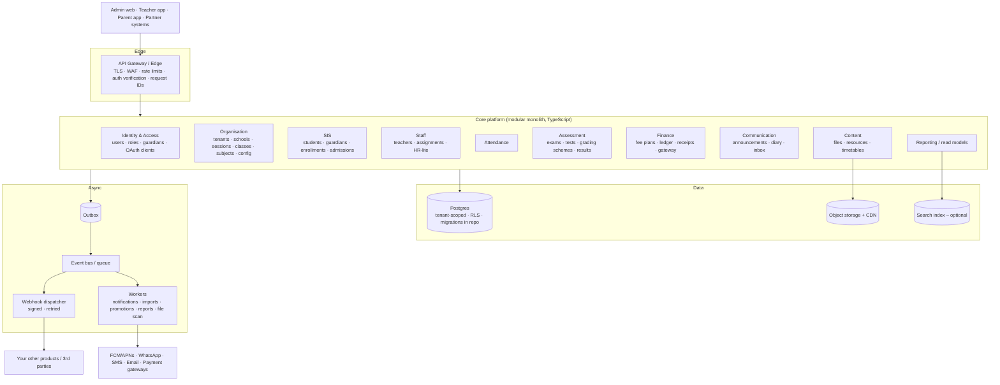

# VPS School ERP Backend: System Analysis, Loopholes & Redesign Drivers

| | |
|---|---|
| **Document** | 2 of 2. Problem analysis |
| **Companion** | [01-api-and-feature-reference.md](./01-api-and-feature-reference.md) (what each API does) |
| **Codebase snapshot** | `main` @ `7a2bd0e` |
| **Reviewed** | 2026-10-29 |
| **Method** | Line-by-line static review of all 118 route files and the `lib/`, `utils/`, `models/` and `middleware.js` files. Nothing was executed against a live database. |

The database schema, RPC functions, constraints and triggers live only in Supabase and aren't in the repository.
Findings that depend on them are marked **(verify)**. File references use `path:line` at the commit above.

---

## Contents

1. [Executive summary](#1-executive-summary)
2. [Severity scale](#2-severity-scale)
3. [Security vulnerabilities (SEC)](#3-security-vulnerabilities-sec)
4. [Data integrity & correctness defects (DAT)](#4-data-integrity--correctness-defects-dat)
5. [Architecture & design problems (ARC)](#5-architecture--design-problems-arc)
6. [Scalability & performance (PERF)](#6-scalability--performance-perf)
7. [API design & consistency (API)](#7-api-design--consistency-api)
8. [Integrability gaps (INT)](#8-integrability-gaps-int)
9. [Operations, reliability & code health (OPS)](#9-operations-reliability--code-health-ops)
10. [Domain hard-coding & functional gaps (DOM)](#10-domain-hard-coding--functional-gaps-dom)
11. [Inconsistency matrices](#11-inconsistency-matrices)
12. [What is worth keeping](#12-what-is-worth-keeping)
13. [Immediate containment plan (before any redesign)](#13-immediate-containment-plan-before-any-redesign)
14. [Redesign drivers: first-principles requirements](#14-redesign-drivers-first-principles-requirements)
15. [Proposed target shape (for discussion)](#15-proposed-target-shape-for-discussion)
16. [Open questions for our next discussion](#16-open-questions-for-our-next-discussion)

---

## 1. Executive summary

**Verdict:** the system works for one small school's day-to-day use, but it isn't safe to run as-is and can't
be the foundation for a scalable, integrable ERP. The functional scope is reasonable: sessions, SIS, attendance,
exams, tests, fees, communication and files. The problems are structural:

1. **Authorization is broken in several places.** Anyone on the internet can create an admin account
   (SEC-01) and push a notification to every phone in the school (SEC-02). Any logged-in student can create, edit and
   delete school announcements (SEC-03) and read every private diary note in the school (SEC-04). Any student can
   read any other student's fee records by changing a number in the URL (SEC-06).
2. **Financial and academic data have no integrity guarantees.** There are no transactions, payments can be
   hard-deleted, there are two parallel fee models that disagree, marks can change after results are declared,
   and there's no audit trail (DAT-01…DAT-08).
3. **Every route is its own island.** Each of the 118 handlers re-implements authentication, validation, business rules, data access and
   response formatting. The result is 7 response envelopes, 5 pagination styles, 3 grading scales and 3 different
   ways to work out "the current session" (ARC-01, API-01…05).
4. **It doesn't scale beyond a few thousand students.** Lists load whole tables into memory and paginate
   afterwards, results are silently truncated at 1,000 rows, notifications fan out with about 3 database round-trips
   per recipient inside the request, and file uploads stream through serverless functions (PERF-01…08).
5. **It isn't integrable.** There's no API contract, no versioning, no machine credentials, no webhooks or events,
   no bulk import or export, no stable external IDs, and the critical database logic isn't in version control (INT-01…07, ARC-03).

### Findings by severity

| Category | Critical | High | Medium | Low | Total |
|---|---:|---:|---:|---:|---:|
| Security (SEC) | 4 | 9 | 8 | 4 | 25 |
| Data integrity (DAT) | 0 | 9 | 14 | 11 | 34 |
| Architecture (ARC) | 0 | 7 | 4 | 0 | 11 |
| Performance (PERF) | 0 | 3 | 6 | 1 | 10 |
| API design (API) | 0 | 1 | 8 | 2 | 11 |
| Integrability (INT) | 0 | 3 | 4 | 0 | 7 |
| Operations (OPS) | 0 | 3 | 4 | 1 | 8 |
| Domain (DOM) | 0 | 1 | 5 | 1 | 7 |
| **Total** | **4** | **36** | **53** | **20** | **113** |

### Top 10 to fix this week, whatever happens with the redesign

| # | ID | Fix |
|---|---|---|
| 1 | SEC-01 | Delete or lock `POST /api/admin/register`. Audit `admin_users` for unknown accounts. Rotate `JWT_SECRET`. |
| 2 | SEC-02 | Delete `POST /api/notifications/event`, or require admin auth on it. |
| 3 | SEC-03, SEC-04 | Switch `admin/announcements*` and `admin/diary-notes` to `authenticateAdmin`. |
| 4 | SEC-06, SEC-16 | Remove the `?studentId=` override from the student fee and attendance endpoints. |
| 5 | SEC-05 | Require auth on `/api/devices` and take `role` and `userId` from the token, not the body. |
| 6 | SEC-07 | Stop returning `teachers.password`. Select explicit columns. |
| 7 | SEC-08, SEC-09, SEC-10 | Add teacher role and class-assignment checks. Whitelist the fields in `PUT /teacher/profile`. |
| 8 | SEC-17 | Remove the legacy Mongo routes `/api/student/notification` and `/api/teacher/dairy/addnote`. |
| 9 | SEC-13, SEC-14 | Add rate limits and attempt counters to login and OTP. Stop logging OTPs. |
| 10 | SEC-15, DAT-08 | Enforce `is_declared` on student result reads. Block mark edits after declaration or publish. |

---

## 2. Severity scale

| Level | Meaning | Target |
|---|---|---|
| **Critical** | Exploitable by an anonymous or lowest-privilege user to gain admin rights, broadcast to the whole school, or read or modify school-wide data | Fix immediately (hours–days) |
| **High** | Significant data exposure, data loss or integrity break, or a design flaw that blocks scale or integration | Fix in the current cycle or design it out in v2 |
| **Medium** | Real defect with a limited blast radius or that needs specific conditions | Fix in v2 |
| **Low** | Hygiene, consistency, maintainability | Address opportunistically / by design |

---

## 3. Security vulnerabilities (SEC)

### Summary

| ID | Sev | Title | Primary location |
|---|---|---|---|
| SEC-01 | **Critical** | Anyone can register an admin account | `app/api/admin/register/route.js:6` |
| SEC-02 | **Critical** | Anyone can send push notifications to the whole school | `app/api/notifications/event/route.js:5` |
| SEC-03 | **Critical** | "Admin" announcement CRUD (with school-wide push) open to any logged-in user | `app/api/admin/announcements/route.js:12,157`, `[id]/route.js:10,75,211` |
| SEC-04 | **Critical** | "Admin" diary-notes open to any logged-in user (read all, write as any teacher) | `app/api/admin/diary-notes/route.js:11,606,670` |
| SEC-05 | High | Unauthenticated device-token registration lets an attacker hijack or eavesdrop on pushes | `app/api/devices/route.js:15,80` |
| SEC-06 | High | IDOR: any user reads any student's fees with `?studentId=` | `app/api/student/fees/summary/route.js:15`, `transactions/route.js:20`, `info/route.js:36` |
| SEC-07 | High | Teacher password hashes returned by admin APIs | `app/api/admin/teachers/route.js:66`, `[id]/route.js:60` |
| SEC-08 | High | Teacher diary endpoints lack a role check, so students can post class-wide notes and pushes | `app/api/teacher/diary/addnote/route.js:8-14` |
| SEC-09 | High | No teacher↔classroom authorization on attendance, roster, diary, resources | `teacher/attendance/route.js:53-94`, `teacher/studentslist/route.js:77`, `teacher/resources/route.js:91-103` |
| SEC-10 | High | Mass assignment in teacher profile update | `app/api/teacher/profile/route.js:130-143` |
| SEC-11 | High | 90-day, non-revocable JWTs, no status re-check, stale claims | `lib/jwt.js:16`, `lib/auth.js:21-39` |
| SEC-12 | High | Password change without the current password and without invalidating sessions | `app/api/users/change-password/route.js:49`, `teacher/profile/change-password/route.js:21` |
| SEC-13 | High | OTP reset flow is brute-forceable and abusable (cost, spam), and OTPs are logged | `auth/forgot-password/route.js:54`, `auth/verify-otp/route.js:37`, `lib/send-otp.js:8` |
| SEC-14 | Medium | No login throttling, and responses allow account enumeration | `auth/teacher/login/route.js:48,62`, `admin/login/route.js:33`, `auth/forgot-password/route.js:44` |
| SEC-15 | Medium | Students see marks before results are declared or published | `results/exams/[examId]/route.js:30-55`, `results/tests/route.js:66-69`, `results/performance/route.js:51,93` |
| SEC-16 | Medium | Attendance accepts `?studentId=` (cross-student read with non-student tokens, name leak) | `app/api/attendance/route.js:62,134` |
| SEC-17 | Medium | Legacy MongoDB endpoints with no auth (read or write notifications) | `app/api/student/notification/route.js:5`, `app/api/teacher/dairy/addnote/route.js:5` |
| SEC-18 | Medium | PostgREST filter-string injection through unescaped interpolation | `admin/students/route.js:136`, `student/resources/route.js:61`, `admin/exams/route.js:160`, `admin/holidays/route.js:189,315` and more |
| SEC-19 | Medium | Unrestricted file upload (size, type, content type) through API memory | `admin/schedules/route.js:137,347`, `teacher/resources/route.js:130` |
| SEC-20 | Medium | Secrets and PII in logs (OTP, phone numbers, JWT claims, full rows) | `lib/send-otp.js:8-15,58`, `student/fees/summary/route.js:14`, `student/resources/route.js:99` |
| SEC-21 | Medium | Service-role DB key everywhere, no RLS, flat "admin" role, no permission model | `utils/supabaseClient.js:18,26`, `lib/auth.js` |
| SEC-22 | Low | CORS `*` and no security headers | `middleware.js:24,34` |
| SEC-23 | Low | Raw database error messages returned to clients | e.g. `admin/students/route.js:61`, `admin/sessions/route.js:97`, `announcements/route.js:91` |
| SEC-24 | Low | Sequential integer IDs make enumeration trivial (amplifies SEC-06/15/16) | all tables |
| SEC-25 | Low | Unauthenticated metadata endpoints | `app/api/metadata/*` |

### Details

#### SEC-01: Anyone can register an admin account (Critical)
- **Where:** `app/api/admin/register/route.js:6-82`. The handler performs no authentication at all.
- **Exploit:** `curl -X POST /api/admin/register -d '{"name":"x","mobile":"9999999999","password":"x"}'` returns an admin
  JWT that's valid for 90 days. The caller can then read every student's personal data, change any family's login
  mobile or password (`updatemobile`, `updatepassword`), delete students, alter fees, delete payments and declare results.
- **Impact:** complete compromise of the school's data, including minors' PII and finance records.
- **Fix:** delete the route, or restrict it to an authenticated super-admin with an invite flow. Audit `admin_users` now for
  unexpected rows. **Rotate `JWT_SECRET`**, because any rogue admin token stays valid for 90 days otherwise (see SEC-11).

#### SEC-02: Anyone can broadcast push notifications (Critical)
- **Where:** `app/api/notifications/event/route.js:5-18` calls `createAndSend` with whatever `recipients` the request supplies.
- **Exploit:** a POST with `recipients: [{role:'all', id:'ALL'}]` sends to the `students`, `teachers` and `admins` FCM topics.
  An attacker can push phishing text ("fees overdue, pay at …") to every parent's phone, branded as the school app,
  and each call also writes a row to `notifications`.
- **Fix:** remove the endpoint, or make it an internal admin-only endpoint with content moderation and an audit log.

#### SEC-03: "Admin" announcements open to any logged-in user (Critical)
- **Where:** every handler in `admin/announcements/route.js` and `admin/announcements/[id]/route.js` uses
  `authenticateUser`, which accepts any valid JWT, instead of `authenticateAdmin`.
- **Exploit:** a student logs in normally and calls `POST /api/admin/announcements`. The announcement is stored and
  pushed to **every** student, teacher and admin device (`route.js:252`). `PUT` and `DELETE` let them change or erase
  real announcements.
- **Fix:** use `authenticateAdmin`. Longer term, require a permission such as `announcements:publish` (see SEC-21).

#### SEC-04: "Admin" diary-notes open to any logged-in user (Critical)
- **Where:** `admin/diary-notes/route.js:11` (GET) and `:606` (POST) use `authenticateUser`. The POST writes
  `teacher_id: body.teacherId` (`:670`).
- **Exploit:** any student can list **every diary entry in the school**, including teachers' personal notes about
  other children, with student names attached. They can also create diary entries for any class or child and
  attribute them to any teacher.
- **Fix:** use `authenticateAdmin`, and take the author from the token instead of the body.

#### SEC-05: Unauthenticated device registration (High)
- **Where:** `app/api/devices/route.js` POST (`:15`) and DELETE (`:80`) have no authentication. `role` and `userId` come from the body.
- **Exploit:**
  - An attacker registers their own FCM token with `{role:'student', userId:<victim>}`. `sync-fcm` then delivers that child's
    personal notifications (attendance, diary text, test scores) to the attacker's device.
  - `{role:'admin'}` subscribes the attacker to the `admins` topic.
  - `DELETE ?token=` lets anyone unsubscribe someone else's device.
- **Fix:** require auth. Derive `recipient_type` and `recipient_id` from the token. Validate `role` against an allowlist before
  using it in a topic name.

#### SEC-06: Fee IDOR through `?studentId` (High)
- **Where:** `student/fees/summary/route.js:15`, `student/fees/transactions/route.js:20` and `student/fees/info/route.js:36`
  all use `searchParams.get('studentId') || auth.user.studentId`.
- **Exploit:** a logged-in student calls `/api/student/fees/summary?studentId=1..N` and harvests every family's fee totals,
  dues and payment history. IDs are sequential (SEC-24), and teacher tokens work too.
- **Fix:** always use the token's `studentId`. For a parent switching between children, use that child's token, or better,
  a parent principal that is authorised for a set of children (see §14).

#### SEC-07: Teacher password hashes in admin responses (High)
- **Where:** `admin/teachers/route.js:66` (`select('*')`) and `admin/teachers/[id]/route.js:60` (`select('*')` spread into the
  response). The `teachers` table has a `password` column (used at `auth/teacher/login/route.js:57`).
- **Impact:** bcrypt hashes go to the admin browser, logs, caches and anyone holding an admin token (combine with SEC-01).
  Offline cracking of weak teacher passwords then gives teacher access.
- **Fix:** select explicit columns, and move credentials into a separate identity store.

#### SEC-08: Teacher diary endpoints have no role check (High)
- **Where:** `teacher/diary/addnote/route.js:8` only calls `authenticateUser`. The same is true of `allnotes` (`:27`) and `deletenote` (`:26`).
- **Exploit:** a student token posts a `Broadcast` entry to any `classroomId`. It's stored with `teacher_id = null` and pushed to
  every student in that class (`:88-108`). A `Personal` entry can be posted for any `enrollmentId`.
- **Fix:** require the teacher role and verify the teacher is assigned to the classroom (SEC-09).

#### SEC-09: No teacher↔classroom authorization on several paths (High)
- **Where:** results and tests do check `teacher_class` (13 files). These paths don't:
  - `POST /teacher/attendance`: writes attendance for any `classroomId` and **any** `enrollmentId`, even one outside that
    classroom (`attendance/route.js:82-94`), and pushes notifications to those families.
  - `GET /teacher/studentslist`: returns the roster of any classroom (`studentslist/route.js:77`).
  - `POST /teacher/diary/addnote`: any classroom (`:51-64`).
  - `POST /teacher/resources`: uploads to any classroom (`resources/route.js:91-103` only checks that the classroom exists).
- **Fix:** add a single `assertTeacherCanAccessClassroom(teacherId, classroomId)` policy and apply it to every teacher route.
  Also respect `valid_upto` (DAT-25).

#### SEC-10: Mass assignment in `PUT /api/teacher/profile` (High)
- **Where:** `teacher/profile/route.js:130` reads the raw JSON body and `:143` writes it with `.update(updateData)`.
- **Exploit:** a teacher can set any column on their own row: `password` (stored as plaintext, which locks the account,
  because bcrypt comparison fails), `email`, `subject`, and any future privileged column such as a role or HR flag.
- **Fix:** whitelist the editable fields with a schema.

#### SEC-11: Token lifecycle (High)
- **Where:** `lib/jwt.js:16` (`expiresIn = '90d'`) and `lib/auth.js:21-39` (role is trusted from the token, nothing is looked up
  in the database).
- **Problems:**
  - No refresh token, logout, revocation list or `token_version`. A stolen or leaked token works for 90 days.
  - A deactivated admin (`admin_users.is_active = false`), a student whose status changed to `Left`, or a deleted teacher
    keeps working access until the token expires.
  - A student token embeds `enrollmentId`, `classId` and `sessionId` (`auth/login/route.js:154-161`). After promotion the app
    keeps reading last year's class (DAT-18).
  - A single shared HS256 secret covers all roles and all clients.
- **Fix:** issue short-lived access tokens (10–15 min) with rotating refresh tokens. Keep a per-user `token_version`
  (or session table) checked on each request. Re-check account status. Use asymmetric keys if other systems need to
  verify tokens.

#### SEC-12: Password change without the current password (High)
- **Where:** `users/change-password/route.js:49` takes only `newPassword` (its doc comment claims it validates the
  current one). `teacher/profile/change-password/route.js:21` does the same.
- **Impact:** anyone holding a token (an unlocked family phone, or a leaked token) can permanently take over the account.
  For parents, the change applies to the shared family login, so **every sibling** is taken over. Existing tokens aren't
  invalidated, and there's no password policy.
- **Fix:** require the current password, enforce a password policy, and bump `token_version` on change.

#### SEC-13: OTP reset flow abuse (High)
- **Where:** `auth/forgot-password/route.js:54` and `resend-otp/route.js:58` (`Math.random()`), `verify-otp/route.js:37-49`
  (no attempt counter), and `lib/send-otp.js:8` (`console.log('OTP:', otp)`).
- **Problems:**
  - No limit on verification attempts per OTP or per mobile. A 6-digit space with a 10-minute window, repeatable through
    `resend-otp`, can be brute-forced with parallel requests.
  - No send-rate limit. Each call sends a **paid WhatsApp template message**, which enables cost abuse ("SMS pumping")
    and harassment of any number in `auth_data`.
  - The OTP is written in plaintext to server logs, so anyone with log access can reset any account.
  - `Math.random` isn't a cryptographically secure random source.
- **Fix:** use `crypto.randomInt`, allow at most 5 attempts per OTP, apply per-mobile and per-IP send limits with backoff,
  remove the OTP log line, and return a generic response for unknown numbers.

#### SEC-14: No login throttling; account enumeration (Medium)
- There's no rate limiting on any login, so credential stuffing and password spraying go unchecked.
- Enumeration paths:
  - Teacher login returns `"Invalid employee ID or "` (`:48`) vs `"Invalid  password"` (`:62`).
  - Admin login reveals "deactivated" before checking the password (`:33`).
  - Forgot-password returns `404 Mobile number not found` (`:44`).
- **Fix:** add a rate limiter (IP + identifier), use uniform error messages, and consider lockout with notification.

#### SEC-15: Results visible before declaration or publication (Medium)
- `GET /api/results/exams/{examId}` reads `exam_summary` and `exam_mark` without checking `exam.is_declared`
  (`results/exams/[examId]/route.js:30-55`). Exam IDs are sequential, so students can watch marks appear while teachers
  are still entering them.
- `GET /api/results/tests` returns every `daily_test_mark` regardless of `daily_test.is_declared` (`results/tests/route.js:66-69`).
- `GET /api/results/performance` averages undeclared exams and marks (`:51-55,93-96`).
- **Impact:** academic integrity. Provisional or erroneous marks reach parents before review.
- **Fix:** filter on `is_declared = true` in every student-facing results query.

#### SEC-16: Attendance `?studentId` override (Medium)
- `app/api/attendance/route.js:62`. With a student token, the attendance rows come from the token's enrollment, but the
  **name** comes from `?studentId` (`:134-138`), which leaks the name of any ID. With a teacher or admin token, which has no
  `enrollmentId`, the fallback path returns **any** student's attendance.
- **Fix:** take identity from the token only. Staff views should be separate endpoints with their own authorization.

#### SEC-17: Legacy unauthenticated MongoDB endpoints (Medium)
- `GET /api/student/notification?student_id=` returns any student's legacy notifications without auth.
- `POST /api/teacher/dairy/addnote` (typo path) lets anyone write notification documents.
- **Fix:** delete both routes and `models/notification.js`.

#### SEC-18: PostgREST filter-string injection (Medium)
- **Where:** user input is interpolated into PostgREST filter grammar, for example
  `query.or(\`name.ilike.%${searchTerm}%,mobile.ilike.%${searchTerm}%,…\`)` (`admin/students/route.js:136`). The same
  pattern appears in `admin/classes:91`, `admin/teachers:70`, `admin/resources:27`, `admin/diary-notes:51`,
  `teacher/resources:261`, **`student/resources:61`** (student-reachable), `admin/exams:160` (`code.eq.${examType}`), and
  `admin/holidays:189,315` (dates).
- **Impact:** a value containing `,` `.` `(` `)` adds arbitrary OR clauses or breaks the query. Outer AND filters still apply,
  so the main risks are filter bypass inside the OR group, errors (500s) and expensive scans.
- **Fix:** escape and validate inputs, or use parameterised SQL (RPC or SQL builder) instead of filter strings.

#### SEC-19: Unrestricted file uploads (Medium)
- **Where:** `admin/schedules/route.js:131-139` and `teacher/resources/route.js:124-142` accept any file. The client-supplied
  `file.type` becomes the S3 `ContentType`, and the whole file is buffered in memory (`arrayBuffer`).
- **Impact:** memory exhaustion and cost, failures past the serverless body limit, and arbitrary content types (HTML or SVG)
  served from the school's bucket through presigned URLs (phishing hosting). There's no malware scanning.
- **Fix:** issue presigned **PUT** URLs with size and type constraints, validate magic bytes server-side, run asynchronous
  AV scanning, and force `Content-Disposition: attachment` for non-media files.

#### SEC-20: Secrets and PII in logs (Medium)
- **Examples:**
  - OTP and mobile number (`lib/send-otp.js:8-9,15`) and the WhatsApp API response (`:58`).
  - Decoded JWT claims (`student/fees/summary/route.js:14`).
  - A full JSON dump of resources (`student/resources/route.js:99`).
  - Enrollment and exam rows (`admin/exams/route.js:188-220`).
  - Schedule rows (`admin/schedules/route.js:48-49,153`).
- There are 52 `console.log` calls in total.
- **Fix:** use structured logging with redaction. Never log secrets, OTPs or tokens.

#### SEC-21: God-mode database access and no permission model (Medium; architectural driver)
- Every query runs with `SUPABASE_SERVICE_ROLE_KEY` (`utils/supabaseClient.js:18,26`), which **bypasses Row Level Security**.
  The only barrier between a caller and the whole database is hand-written `if` checks repeated in 118 files. SEC-03,
  SEC-04, SEC-08 and SEC-09 are exactly the places where one of those checks was forgotten.
- There's a single `admin` role with full power. You can't express "fees clerk", "exam coordinator", "class teacher"
  or "principal (read-only finance)". The admin role isn't even read from `admin_users.role`, because the token hard-codes `'admin'`.
- **Fix (v2):** a central policy layer (RBAC with permissions plus resource scoping), and defence in depth with database RLS
  that uses per-request JWT claims or a least-privilege DB role.

#### SEC-22: CORS wildcard and missing headers (Low)
- `middleware.js:24,34` sets `Access-Control-Allow-Origin: *`. Tokens travel in headers rather than cookies, so this
  alone isn't exploitable, but it's an unnecessary exposure. There are no `Strict-Transport-Security`,
  `X-Content-Type-Options` or `Cache-Control: no-store` headers on sensitive responses.

#### SEC-23: Raw DB errors leak to clients (Low)
- Examples: `{ error: error.message }` (`admin/students/route.js:61,444`), `message: error.message` (`admin/sessions/route.js:97,187`),
  and the public announcements list (`announcements/route.js:91`). These reveal table and constraint names.

#### SEC-24: Enumerable sequential IDs (Low)
- All primary keys are integers exposed in URLs (`/students/123`, `/exams/45`), which makes the IDOR classes above trivial.
  Use opaque public IDs (UUIDv7 or ULID) at the API edge.

#### SEC-25: Unauthenticated metadata (Low)
- `GET /api/metadata/subjects` and `/exam-types` are public. The impact is negligible, but it isn't intentional design.

---

## 4. Data integrity & correctness defects (DAT)

### Summary

| ID | Sev | Title |
|---|---|---|
| DAT-01 | High | No database transactions for multi-step writes |
| DAT-02 | High | Financial records are hard-deleted, with no void, reversal, audit or actor |
| DAT-03 | High | Two parallel fee models (`fee_summary` vs schedule/installment/allocation) that disagree |
| DAT-04 | High | Payments and fee schedules don't create allocations or installments in code (verify triggers) |
| DAT-05 | High | Admin student fee detail returns 404 for every promoted student |
| DAT-06 | Medium | Fee and payment writes target the "highest enrollment_id", not a chosen session |
| DAT-07 | Medium | Fee schedule update validates `dueDate` but never saves it |
| DAT-08 | High | Marks can change after results are declared or published |
| DAT-09 | Medium | Four guards read `count` from the wrong field and never fire |
| DAT-10 | Medium | Three grading scales; inconsistent ranking (no tie handling for exams) |
| DAT-11 | Medium | Promotion: class counter never updated; per-student partial writes; status strings |
| DAT-12 | High | Attendance is insert-only and unvalidated (duplicates, cross-class rows, holidays, future dates) |
| DAT-13 | High | Student hard delete cascades through academic and financial history |
| DAT-14 | Medium | Student read and update defects (wrong session, undefined filter, auto-created classrooms, roll-number lookup) |
| DAT-15 | Medium | Student status vocabulary is inconsistent and unconstrained |
| DAT-16 | High | Changing a mobile silently merges a child into another family's login; creates password-less logins |
| DAT-17 | Medium | Session activation is non-atomic; "current session" is resolved 3 different ways |
| DAT-18 | Medium | Student JWT freezes the enrollment, class and session for 90 days |
| DAT-19 | Medium | Exam creation continues after insert failure, uses a raw string as a foreign key, seeds inactive students |
| DAT-20 | Low | Exam subjects exist only implicitly in `exam_mark`; "publish subject" isn't persisted |
| DAT-21 | Low | Admin dashboard KPIs wrong or placeholder |
| DAT-22 | Medium | Broadcast notifications share one row, so they can't be marked read per user |
| DAT-23 | Low | Holiday overlap rule is global; holidays can't be nested; session can't be chosen |
| DAT-24 | Medium | Teachers can't get an initial password through the API; `phone_no` vs `mobile` mismatch |
| DAT-25 | Medium | Duplicate teacher assignments lock teachers out; expired assignments still authorize |
| DAT-26 | Low | Money handled as JS floating point; no currency or precision model |
| DAT-27 | Low | Ad-hoc time-zone handling (manual +5:30, server-TZ-dependent date maths) |
| DAT-28 | Low | Clone-structure partial failure leaves the target session stuck |
| DAT-29 | Low | Student exam detail crashes (500) when marks exist but results weren't generated |
| DAT-30 | Low | FCM dispatcher splits `role-id` keys on `-` |
| DAT-31 | Low | Schedules: version number race; deleting the current version leaves none current |
| DAT-32 | Low | The user's "notifications off" preference is ignored |
| DAT-33 | Medium | Performance averages count absences as 0 and turn null marks into NaN |
| DAT-34 | Low | Uploaded resources rely on the DB default for `is_public` (verify) |

### Details

#### DAT-01: No transactions (High)
Every multi-step write is a series of independent HTTP calls to PostgREST. Any failure mid-way leaves partial state:

| Operation | Steps | File |
|---|---|---|
| Promote student | insert enrollment → insert fee_summary → update classroom count → insert promotion_history (×N students, sequential) | `admin/promote/route.js:133-296` |
| Clone session | insert classrooms → insert teacher_class → insert fee_structure (errors in later steps are swallowed) | `admin/sessions/clone-structure/route.js:104-210` |
| Activate session | deactivate all → activate one (zero active sessions if step 2 fails) | `admin/sessions/activate/route.js:46-72` |
| Update student + move class | update student → find or create classroom → update enrollment | `admin/students/[studentId]/route.js:384-456` |
| Change login mobile | insert auth_data → update student | `admin/students/[studentId]/updatemobile/route.js:98-137` |
| Create exam | insert exam → insert exam_mark rows (insert error is ignored) | `admin/exams/route.js:180-227` |
| Publish schedule | S3 put → insert row → flip other versions | `admin/schedules/route.js:139-170` |

`register_student` is the only RPC that is (probably) atomic. **Fix:** put a domain service layer over Postgres
transactions (direct SQL connection or RPCs), with idempotency on retried commands.

#### DAT-02: Financial records hard-deleted (High)
- `DELETE /admin/fees/{studentId}/transactions/{id}` physically deletes a payment (`…/[transactionId]/route.js:52-55`).
  The code even comments "In production we might prevent deleting completed transactions". Fee schedules are
  deleted the same way (`…/fees/[feeId]/route.js:158`).
- No record is kept of who recorded, edited or deleted a payment (no `created_by`), there's no receipt numbering, and
  there's no reversal or void entry. Any admin, including one created through SEC-01, can make money disappear
  without a trace.
- **Fix:** an append-only ledger (payments, refunds, reversals, adjustments), immutable receipts with sequential numbering,
  maker-checker approval for reversals, and a full audit log.

#### DAT-03: Two fee models (High)
- **Legacy:** `fee_summary` (`school_fees, bus_fees, other_fees, discount, paid_fees, due`) is read by the
  student fee summary (`student/fees/summary/route.js:23`) and the promotion preview (`promote/preview/route.js:91-94`), and
  is written **as all zeros** on promotion (`promote/route.js:174-184`).
- **New:** `fee_schedule → fee_installment → fee_allocation ← fee_transaction` is used by every admin fee screen and by the
  student installment view.
- **Consequence:** the parent app's "total fee / paid / due" comes from a different source than the admin's fee list.
  `dueFromLastYear` sums `fee_summary.due` across enrollments, but promotion zeroes the new row and nothing
  carries the arrears forward, so dues can vanish or double-count depending on what the triggers do (verify).
- **Fix:** one fee domain model, with the summary as a derived projection.

#### DAT-04: No allocation or installment creation in code (High, verify)
- `POST /admin/fees/{studentId}/fees` inserts only `fee_schedule` (`fees/route.js:97-109`). The comment says "schedule + initial
  installment" but no installment is created. `POST …/transactions` inserts only `fee_transaction` (`transactions/route.js:81-85`).
- Every "paid" figure in admin views comes from `fee_allocation` (`admin/fees/route.js:90-104`, `admin/fees/[studentId]/route.js:93-108`).
  Unless hidden DB triggers create installments and allocate payments, newly recorded payments never show as paid.
- **Fix:** make allocation an explicit domain operation (FIFO by due date or targeted), visible in code and tested.

#### DAT-05: Fee detail breaks after promotion (High)
- `admin/fees/[studentId]/route.js:25-33` selects `student_enrollment` by `student_id` with `.single()`. Any student with two
  or more enrollments (that is, everyone after the first rollover) gets PostgREST error `PGRST116`, which the code maps to
  **404 "Student not found"**.
- **Fix:** scope the lookup by session (or enrollment ID) explicitly.

#### DAT-06: Fee writes target the "latest enrollment" (Medium)
- `fees/route.js:61-67`, `transactions/route.js:53-59` and `student/fees/transactions/route.js:33-41` pick the highest
  `enrollment_id`. Recording a late payment against last year's dues, or a fee for a specific session, isn't possible.
  After promotion, payments land on the new session automatically.

#### DAT-07: Fee due date never updated (Medium)
- `fees/[feeId]/route.js:48-54` validates `dueDate` into `dueDateISO`, but `updates` (`:64-70`) never includes it. The API
  reports success while the change is silently dropped.

#### DAT-08: Marks can change after declaration or publication (High)
- Admin marks update (`admin/exams/[examId]/students/[studentId]/marks/route.js:23-30`) has a comment
  "Ensure exam not declared" but **no check**. The absent route behaves the same way (`…/absent/route.js:24-29`).
- `PUT /admin/exams/{id}/generate-results` can re-run after declaration and silently change published ranks.
- `PUT /admin/exams/{id}` edits declared exams.
- Teacher test marks upsert (`teacher/result/tests/[testId]/students/[studentId]/route.js:43-50`) fetches `is_declared` and ignores it.
- Admin edits record `updated_by: null`, so there's no audit of who changed a mark.
- **Fix:** a state machine (draft → marking → moderated → declared → amended-with-reason), an immutable audit of mark changes,
  and regeneration only through an explicit "amend results" workflow.

#### DAT-09: Guards that never fire (Medium)
With `select(…, { head: true, count: 'exact' })` the count is returned on the **response**, while `data` is `null`.
Four places read `data.count`, so the value is always `undefined`:

| Location | Intended guard | Actual effect |
|---|---|---|
| `admin/exams/[examId]/route.js:410-414` | Block deleting an exam that has results | Never blocks |
| `admin/exams/[examId]/students/[studentId]/absent/route.js:43-49` | Block marking absent once marks exist | Never blocks, so real marks are overwritten with 0 |
| `teacher/result/exams/…/publish/route.js:37-44` | Block publishing while marks are pending | Never blocks |
| `teacher/result/tests/route.js:96-100` | Student count per test | Always 0 |

#### DAT-10: Grading and ranking inconsistency (Medium)
- **Scale A** (`generate-results/route.js:13-23`, stored in `exam_summary.grade`): A+ ≥ 90, A ≥ 80, **B ≥ 70, C ≥ 60, D ≥ 50, E ≥ 40**, F.
- **Scale B** (`admin/exams/[examId]/route.js:325-336`, teacher exam and test routes, `results/tests`): A+ ≥ 90, A ≥ 80, **B+ ≥ 70, B ≥ 60, C ≥ 50, D ≥ 40**, F.
- So a 72% student is shown "B" overall and "B+" per subject. A 45% student is "E" overall and "D" per subject.
- Exam ranks are positional (`index + 1`, `generate-results:95-98`), so tied students get different ranks, and absent
  students are ranked *below* everyone present. Test ranks are dense with ties (`tests/[testId]/rank/route.js:86-98`).
  The pass threshold (40%) is hard-coded (`admin/exams/[examId]/route.js:258-261`).
- **Fix:** configurable grading schemes per board, class or session, one ranking policy (competition or dense, with a tie
  rule), and computation in exactly one place.

#### DAT-11: Promotion defects (Medium)
- **Counter never updated:** the classroom `total_student` "+1" (`promote/route.js:194-206`) builds an update query inside `.then()` and
  never awaits or returns it. A Supabase query builder only executes when awaited, so **the update never runs**. Even if it
  did, a read-modify-write would race under concurrency. Many screens show `total_student`.
- **No atomicity:** each student takes up to 4 round-trips, and `fee_summary` and `promotion_history` errors are
  swallowed. A partially promoted student can be left without a fee row or history.
- **Unconstrained statuses:** passed-out students get `'Passed Out'` and transferred students get `'Left'`
  (`:232,262`), but the status endpoint only accepts `Active|Paused|Leave` (DAT-15).
- **No target validation:** nothing checks that `toClassroomId` belongs to `toSessionId`.

#### DAT-12: Attendance defects (High)
- `teacher/attendance/route.js:91-94` uses a plain `insert`. Re-submitting a corrected register either creates duplicate rows
  (if there's no unique constraint, which skews percentages) or fails with a 500 (verify the constraint). There's no
  update-attendance endpoint at all.
- There's no check that `enrollmentId` belongs to `classroomId`, that the date isn't in the future, or that it isn't a holiday or
  Sunday, and nothing stops two teachers marking the same class.
- The student calendar keeps only one record per day (`attendance/route.js:189-194`), so duplicates are hidden there but still counted elsewhere (RPC summaries, admin dashboard).
- **Fix:** idempotent upsert on `(enrollment_id, date[, period])`, validation, edit audit, and period-wise attendance if needed.

#### DAT-13: Student hard delete (High)
- `admin/students/[studentId]/route.js:520-524` deletes the student. The comment relies on FK cascade "to enrollments", which
  cascades on to attendance, marks, fee schedules and payments (verify cascade rules). One click destroys years of
  records, including statutory ones (admission register, TC history).
- **Fix:** soft delete or archive, with retention and legal-hold rules.

#### DAT-14: Student read and update defects (Medium)
- **Session resolution:** `PUT /admin/students/{id}` resolves the "current session" by `start_date` desc (`:398-404`) rather than
  `is_active`, and the enrollment as the latest `created_at` (`:357-363`).
- **Undefined medium filter:** the classroom lookup filters on `enrollment.classrooms.medium` (`:420`), but `medium` isn't in
  the select (`:359`), so it's always `undefined`.
- **Auto-created classrooms:** if no classroom matches, one is **created** with medium `English` (`:428-442`). A typo
  creates a phantom class.
- **Roll-number lookup:** `GET /admin/students?rollNo=` without `class` ignores the session and uses `.single()`
  (`admin/students/route.js:335-371`). Roll numbers repeat across classes and years, so this returns a 404 or error.
- **Typo field:** `addmissionDate` is the real field name (`admin/students/route.js:55`).
- **No password check:** `POST` hashes `data.password` without checking that it exists, so a missing password causes a 500.

#### DAT-15: Student status vocabulary (Medium)
- The values written are `Active`, `Paused`, `Leave` (`status/route.js:63`), `Passed Out` and `Left` (promotion). The error message
  lists `Active, Inactive, Graduated, Transferred, Dropped`, and the promotion doc comments say `Transferred`. Login treats
  anything other than `Active` as restricted. Without a DB enum or check constraint, reports by status are unreliable.

#### DAT-16: Mobile change merges families (High)
- `updatemobile/route.js:98-110`: if the new mobile already exists in `auth_data`, the student is re-pointed to **that family's
  login** without confirmation. A typo by an admin hands one family's child to a stranger, who then sees the child's attendance, marks
  and fees.
- If the mobile is new (`:113-119`), a password-less `auth_data` row is created. Login then calls `bcrypt.compare(password, null)`,
  which throws and produces a 500 until an admin sets a password. The old `auth_data` row is orphaned.
- **Fix:** model guardians explicitly (person ↔ student relationship with a role), and make linking a deliberate, verified action.

#### DAT-17: Session activation and resolution (Medium)
- Activation is two statements (`activate/route.js:46-72`). Concurrent calls or a failure can leave zero or two active
  sessions (verify whether there's a partial unique index).
- "Current session" is computed in three ways: `is_active` with a fallback to latest `start_date` (`sessionHelper.js:20-46`),
  latest `start_date` only (`admin/exams/route.js:136-142` (unused), `admin/students/[studentId]/route.js:398-404`), or the JWT's
  `sessionId` (student routes). A school preparing next year's session early gets mixed behaviour.

#### DAT-18: Stale academic context in tokens (Medium)
- Student routes trust `enrollmentId` and `classId` from the token (`dashboard/route.js:41`, `diary/route.js:38`,
  `student/resources`, `student/schedules`). After promotion the app shows the old class's diary, timetable and
  resources for up to 90 days unless the parent logs out and back in. This was the subject of the last merged PR (#29),
  and it isn't fully solved.

#### DAT-19: Exam creation defects (Medium)
- **Continues after failure:** an exam insert error is only logged (`admin/exams/route.js:186`), and the code then dereferences `examRow.exam_id`,
  which crashes with a generic 500 after a partial write.
- **Raw string as foreign key:** if `examType` doesn't match, the raw string is used as `exam_type_id` (`:165`).
- **Inactive students seeded:** seeding creates `exam_mark` rows for **every** enrollment in the classroom (`:191-195`), including students
  who have left or are paused. Their blank marks then block `generate-results` (`MARKING_INCOMPLETE`). The teacher
  add-subject path does the same (`teacher/result/exams/[examId]/subjects/route.js:150-160`).

#### DAT-20: Implicit exam structure (Low)
- There's no `exam_subject` table. The subject list, max marks and roster are inferred from `exam_mark` rows. Max marks are
  duplicated per student, so they can diverge. An exam with no seeded rows has "no subjects". Per-subject publish has
  "No dedicated column" (`publish/route.js:48`), so the API returns success without storing anything.

#### DAT-21: Admin dashboard metrics (Low)
- **Total announcements** is read from the wrong response, so it's always 0 (`admin/dashboard/route.js:196`).
- **"Active" announcements** are counted from only the 5 recent rows (`:199-203`).
- **Class attendance** comes from an RPC with no session argument (`:118`).
- **Fee collection** is a hard-coded 0 (`:225`).
- **Total teachers** counts every teacher ever (`:100-103`).

#### DAT-22: Broadcast read state (Medium)
- A broadcast is one row with `recipient_id = 'ALL'` (`lib/notifications/index.js:57-69`). Mark-read filters on
  `recipient_id = <self>` (`notifications/[id]/read/route.js:21-26`, `read-all/route.js:17-22`), so broadcasts can **never** be
  marked read and the unread badge only grows. If it did match, one user's read would mark it read for everyone.
- **Fix:** keep the message separate from per-recipient delivery and read receipts (`notification`, `notification_receipt`).

#### DAT-23: Holidays (Low)
- POST and PUT reject a holiday that overlaps **any** holiday in **any** session (`holidays/route.js:185-207,306-334`), so a
  festival inside a vacation can't be recorded. New holidays are always attached to the active session.

#### DAT-24: Teacher credential provisioning (Medium)
- `POST /admin/teachers` creates a teacher with no password (`teachers/route.js:7-13,125-129`), and no admin endpoint sets one.
  Teacher login rejects null passwords (`auth/teacher/login/route.js:57`). Onboarding therefore needs direct DB access.
- Login reads `teacher.phone_no` (`:88`) while admin and profile use `mobile`, so one of them is always empty (verify).

#### DAT-25: Teacher assignment integrity (Medium)
- Nothing prevents duplicate `teacher_class` rows: assignment doesn't check for them, and clone-structure copies them. Teacher
  authorization uses `.maybeSingle()` without `limit(1)` in several routes (`teacher/result/tests/route.js:39-44`,
  `exams/[examId]/rank/route.js:26-31`). With two matching rows PostgREST returns an error, `data` is `null`, and the teacher
  gets **403** for their own class.
- `valid_upto` (temporary assignments) is ignored by every authorization check.

#### DAT-26: Money as floats (Low)
- All amounts go through JS `Number` and `+=`. Totals can drift (0.1 + 0.2). There's no currency per amount, no rounding
  policy, and no tax or concession model.

#### DAT-27: Time zones (Low)
- IST formatting adds +5:30 manually and then uses local getters (`admin/schedules/route.js:9-30`), which gives the wrong
  result if the server isn't in UTC.
- Attendance builds dates with `new Date('YYYY-MM-DD')` (UTC) but uses local `getDay()` and `setDate()` (`attendance/route.js:174-178,204`).
- "Today" comes from UTC (`new Date().toISOString().split('T')[0]`) in many routes, so between 00:00 and 05:30 IST "today" is yesterday.
- `diary_entries.created_at` stores a date, not a timestamp.

#### DAT-28: Clone-structure can strand the target session (Low)
- If teacher or fee cloning fails, it's logged and skipped, but classrooms already exist. A retry is refused with 409
  "Target session already has classrooms" (`clone-structure/route.js:66-81`). The only way out is manual DB work.

#### DAT-29: Exam detail crash (Low)
- `results/exams/[examId]/route.js:94-95` dereferences `summary.total_marks` when no summary exists, which produces a 500.

#### DAT-30: FCM key parsing (Low)
- `sync-fcm.js:68,73` builds `"${type}-${id}"` keys and splits on `-`. Any recipient ID containing `-` (UUIDs in the future) breaks delivery.

#### DAT-31: Schedule versions (Low)
- The next version is computed as `max + 1` without a lock (`admin/schedules/route.js:35-53`). Concurrent uploads collide.
- Deleting the current row (`:431-436`) leaves the class with **no current schedule** instead of reverting to the
  previous version. The S3 object is kept forever.
- `PUT` with a new file rewrites the existing row, which destroys version history.

#### DAT-32: Notification preference ignored (Low)
- `PUT /users/settings {notifications:false}` is stored in Mongo but never consulted by `createAndSend`.

#### DAT-33: Performance analytics (Medium)
- `results/performance/route.js:104-112`: absent subjects count as 0%, and null marks (not yet entered) produce `NaN`, which
  then becomes `null` in JSON. The subject averages shown to parents can be wrong. The figures also include undeclared exams (SEC-15).

#### DAT-34: Resource visibility default (Low, verify)
- Teacher uploads never set `is_public` (`teacher/resources/route.js:145-160`), while students only see `is_public = true`.
  Whether students can see uploads at all depends on the column default.

---

## 5. Architecture & design problems (ARC)

| ID | Sev | Problem | Evidence | Consequence |
|---|---|---|---|---|
| ARC-01 | High | **No layering.** Each route mixes auth, validation, business rules, SQL and formatting | 118 handlers; response helpers redefined in 14 files; grade functions in 6; MIME helpers in 3; enrollment-lookup helpers in 6; class order defined twice | Every rule is copied, and copies diverge (DAT-10, SEC-03/04/08) |
| ARC-02 | Medium | **Two databases without a reason.** Postgres plus MongoDB for OTPs, reset tokens, preferences and a dead notification system | `utils/dbconnect.js`, `models/*` | Two connection pools per cold start, two backup and DR stories, no joins or transactions across them |
| ARC-03 | High | **Critical logic lives in the database but not in the repo.** RPCs, triggers, generated columns, constraints, indexes | `register_student`, `get_*_summary`, `net_due`, `due`, allocation (DAT-04) | The system can't be rebuilt, reviewed, tested or migrated from source. Behaviour is partly invisible. |
| ARC-04 | High | **Fragmented identity.** Three user tables, three login identifiers, three token shapes, role inferred from claim presence, password stored on the `teachers` business row, family-shared parent password | `auth_data`, `teachers.password`, `admin_users` | No SSO, no multi-role users (teacher who is also a parent), no per-guardian logins, hard to secure (SEC-07/11/12) |
| ARC-05 | High | **No authorization model.** No policy layer, no permissions, no resource scoping, service-role DB access | SEC-21 | Each new route is a new chance to forget a check |
| ARC-06 | Medium | **Academic-session context is implicit.** It's resolved differently per route and frozen in tokens | DAT-17, DAT-18 | Wrong-year data, fragile rollover |
| ARC-07 | High | **Side effects inline or fire-and-forget.** Notifications run in the request path or as un-awaited promises after the response. The queue driver is a stub. | `teacher/attendance/route.js:153`, `teacher/diary/addnote/route.js:117`, `tests/[testId]/publish/route.js:98`, `redis-queue.js` | On serverless, work after the response can be frozen or killed, so notifications are silently lost. There's no retry, outbox or dead-letter queue. |
| ARC-08 | Medium | **File bytes stream through API functions** | `formData()` + `arrayBuffer()` in schedules and resources | Body-size limits, memory pressure, cost, no resumable uploads (PERF-08) |
| ARC-09 | High | **Single tenant, single school.** No `school_id` or `tenant_id`, plus hard-coded locale and curriculum (DOM-*) | whole schema | Can't host multiple schools or branches, or sell as SaaS |
| ARC-10 | High | **No audit log, history or domain events** (only `promotion_history`) | — | No accountability for marks, fees or attendance changes. Nothing for integrations to subscribe to. |
| ARC-11 | Medium | **Import-time side effects and coupling.** Firebase initialises at module load with a `{}` fallback. Supabase and S3 log "connected" without connecting. | `sync-fcm.js:8-13`, `devices/route.js:7-12`, `utils/s3Client.js:12`, `utils/supabaseClient.js:29` | A missing env var crashes every route that imports notifications (attendance, announcements, diary, tests) at load time. Misleading logs. |

---

## 6. Scalability & performance (PERF)

| ID | Sev | Problem | Evidence | Fix direction |
|---|---|---|---|---|
| PERF-01 | High | **Fetch-everything, then filter and paginate in memory** | `admin/fees/route.js:35-169` (all enrollments, schedules, allocations); `admin/transactions/route.js:41-120` (filters **after** paging, so pages are short and totals wrong); `admin/diary-notes` search (all matches from 3 queries); `results/tests` (all test marks); `student/fees/info`; **`teacher/result/tests/route.js:72-74` (reads the entire `daily_test_mark` table for every request)** | Push filtering, aggregation and pagination into SQL (views, materialised projections) |
| PERF-02 | High | **Silent truncation at the PostgREST row limit** (Supabase default 1,000) | Same endpoints as PERF-01. Above about 1,000 students or marks, totals and lists quietly become wrong | Paginate in SQL. Never rely on implicit limits. |
| PERF-03 | Medium | **Unbounded `.in()` lists** built from earlier results | `admin/fees/route.js:73-92`, `admin/transactions/route.js:81-88`, `admin/exams/[examId]/route.js:111-135` | Joins or RPCs instead of ID lists in URLs (URL-length and 414 risk) |
| PERF-04 | High | **N+1 and sequential round-trips** | Promotion: about 5 sequential calls per student (1,000 students ≈ 5,000 calls in one request, so serverless timeouts); admin marks: one UPDATE per subject; teacher marks: one HTTP call per student per subject | Set-based SQL; bulk endpoints; background jobs for rollover |
| PERF-05 | Medium | **Notification fan-out cost** | `createAndSend` per student: template query + insert + token query + FCM call. Attendance for 40 students ≈ 120+ DB calls plus 40 FCM calls; test publish the same. | Batch recipients into one insert, queue delivery, cache templates |
| PERF-06 | Medium | **Repeated "active session" lookups** (up to 2 queries) on most requests, never cached | `sessionHelper.getActiveSession` used in 15 routes; login repeats it inline | Cache the session in config or tenant context; pass it explicitly |
| PERF-07 | Medium | **Expensive search and count patterns** | 18 leading-wildcard `ilike '%x%'` filters; `count: 'exact'` on 34 queries | Trigram or full-text indexes, a search service, estimated counts or keyset pagination |
| PERF-08 | Medium | **Uploads through functions** | SEC-19, ARC-08. Videos (`video/mp4` is an allowed resource type) exceed typical serverless body limits | Direct-to-S3 presigned PUT and multipart upload |
| PERF-09 | Medium | **No bulk APIs** | Mark entry is one call per student per subject; no bulk student import, fee assignment or attendance edit | Bulk and batch endpoints with partial-success reports |
| PERF-10 | Low | **Cold-start weight** | Each function may initialise Firebase Admin, Mongoose and Supabase clients | Fewer SDKs; lazy init; long-lived workers for heavy tasks |

---

## 7. API design & consistency (API)

| ID | Sev | Problem | Examples |
|---|---|---|---|
| API-01 | Medium | **Seven response envelopes** (see doc 1 §8.1) | `{status:'success'}` vs `{success:true}` vs `{message, token}` vs bare objects vs top-level arrays |
| API-02 | Medium | **HTTP status codes misused** | `formatError()` always returns **400**, even for `INTERNAL_ERROR` and `NOT_FOUND` (admin teachers, classes); teacher PUT and DELETE map every failure to `NOT_FOUND`; `results/tests` returns **200** with `success:false`; the teacher-login body repeats `status` |
| API-03 | Medium | **Naming chaos** | `session_id`/`sessionId`, `classroom_id`/`classroomId`/`classId`/`class_id`, `exam_id`/`examId`; typos `dairy`, `addmissionDate`; `examId` in the results list actually holds `exam_type_id` |
| API-04 | Medium | **RPC-style and irregular resources** | Verbs in paths (`addnote`, `deletenote`, `allnotes`, `updatemobile`, `updatepassword`); `PUT` for actions (`declare`, `generate-results`, `publish`); IDs in query strings for `PUT`/`DELETE` (`classes`, `holidays`, `schedules`, `sessions`); `DELETE` with a JSON body (`teachers/{id}/classes`); `POST` for read-only preview |
| API-05 | Medium | **Five pagination styles** and different default sizes | `page/limit`, `page/pageSize`, `offset/limit`; meta keys `pages`/`totalPages`, `hasNext`/`hasNextPage`, `total`/`totalItems`/`totalEntries`/`totalStudents` |
| API-06 | Low | **Duplicated and overlapping endpoints** | Three subject lists, two exam-type lists, three announcement readers, two diary systems, two notification systems |
| API-07 | High | **No contract or versioning** | No OpenAPI or JSON Schema, no `/v1`, existing `docs/` covers about 10 endpoints and is stale, README describes a different stack (Express, MongoDB, NextAuth, Next 14) |
| API-08 | Medium | **No idempotency or concurrency control** | A retried `POST …/transactions` double-records a payment; no `Idempotency-Key`; no ETag or `If-Match` on updates, so last write wins on marks and fees |
| API-09 | Medium | **Validation ad hoc** | zod in 3 files only; marks aren't checked against `0 ≤ marks ≤ max_marks` (verify DB constraint); no string length limits on most inputs; dates validated by regex or `new Date()` inconsistently |
| API-10 | Medium | **Output inconsistencies** | `endDate: null` returned while it's stored; IDs as strings in some places, numbers in others (`id: announcement_id.toString()`); `TXN001` vs `TXN1`; zero-padded `rollNo` strings in teacher APIs, numbers elsewhere; dates mixed (`dd/mm/yyyy, hh:mm:ss` IST strings vs ISO) |
| API-11 | Low | **Documented but unimplemented parameters** | `feeType` on `/admin/transactions`; `subject` on teacher exams; `upcomingEvents` and `feeCollection` placeholders |

---

## 8. Integrability gaps (INT)

You want this system to plug into other products you're building. Today there's no supported way for another system
to integrate with it.

| ID | Sev | Gap | Why it matters |
|---|---|---|---|
| INT-01 | High | **No machine-to-machine authentication.** No API keys, OAuth2 client credentials, scopes or per-integration rate limits | Other services would have to impersonate a human admin with a 90-day token |
| INT-02 | High | **No outbound events or webhooks.** Nothing announces `student.admitted`, `attendance.marked`, `result.declared` or `payment.recorded` | Other systems (accounting, transport, CRM, analytics, messaging) can only poll |
| INT-03 | Medium | **No stable external identifiers.** Sequential internal IDs only; `sr_no` and `nic_id` aren't unique keys; no `external_ref` | Safe upserts and cross-system reconciliation aren't possible |
| INT-04 | Medium | **No bulk import or export, and no delta sync.** No CSV or Excel import (students, fees, marks); no "changes since" feed; no report exports | Onboarding a school means manual entry; BI and data-warehouse feeds aren't possible |
| INT-05 | High | **No contract, SDK or sandbox** (see API-07) | Integrators can't code against a spec or generate clients; breaking changes go unnoticed |
| INT-06 | Medium | **No payment gateway or accounting integration.** Payments are typed in by admins; no gateway webhooks, reconciliation, or ledger export (Tally/GL) | Core ERP finance workflows are missing |
| INT-07 | Medium | **No SSO or federated identity**, and messaging is hard-wired to WhatsApp, FCM and S3 | Swapping providers or adding SMS, email or IVR means rewriting routes |

---

## 9. Operations, reliability & code health (OPS)

| ID | Sev | Problem | Evidence |
|---|---|---|---|
| OPS-01 | High | **No automated tests, no CI** | No test files, no `.github/` workflows, `lint` script never enforced |
| OPS-02 | High | **No migrations, seed data or env template** | Schema, RPCs and triggers exist only in Supabase; `.env.example` referenced by the README doesn't exist |
| OPS-03 | High | **No observability** | 52 unstructured `console.log` calls (some with PII, SEC-20); no request IDs, metrics, tracing, error tracking or alerting; failed pushes only visible in `send_failures` |
| OPS-04 | Medium | **No rate limiting or abuse controls anywhere** | middleware is CORS only (SEC-13/14) |
| OPS-05 | Medium | **Dead, legacy and commented code** | Mongo notification stack, redis-queue stub, commented fees and results blocks, unused `signGetUrl` (which signs a *PutObject* command), boilerplate `app/page.js` and `layout.js` ("Create Next App") |
| OPS-06 | Medium | **Runtime and dependency hygiene** | Synchronous `params` access in 24 places (deprecated in Next 15, removed later); deprecated Mongoose options `useNewUrlParser`/`useUnifiedTopology`; JS without types for a finance-bearing system |
| OPS-07 | Medium | **Documentation drift** | README feature list (salary, expenses, reports, assignments) and tech stack don't match the code; existing `docs/` covers the deprecated Mongo diary |
| OPS-08 | Low | **No health or readiness endpoints; no documented backup, restore or DR** | — |

---

## 10. Domain hard-coding & functional gaps (DOM)

| ID | Sev | Hard-coded rule or gap | Where |
|---|---|---|---|
| DOM-01 | Medium | Class ladder `Nursery, LKG, UKG, 1–10` | `utils/classProgression.js:11-17`, `admin/classes/route.js:28-49` (duplicate) |
| DOM-02 | Medium | Grade bands (3 variants), pass mark 40%, absent counts as F | DAT-10 |
| DOM-03 | Medium | Weekly off = Sunday only; session default April–March | `attendance/route.js:216,249-253` |
| DOM-04 | Medium | Locale: `+91` prefix, INR, IST offset, WhatsApp template language `en_US` | `lib/send-otp.js:12-14,30`, `admin/schedules/route.js:19`, fee routes |
| DOM-05 | Low | Fee category map `{1:'School Fee',2:'Bus Fee',3:'Extra Fee'}`; installment names; medium initial `(E)/(H)` | `student/fees/transactions/route.js:5-9`, `student/fees/info/route.js:6-25`, `teacher/classlist/route.js:99` |
| DOM-06 | High | **Missing ERP modules** (some claimed in the README) | Admissions and enquiries, guardian management, staff HR, leave, payroll, timetable as structured data (periods, substitutions), events CRUD, transport, library, inventory, accounting/GL, receipts and invoices, report-card and TC generation, parent↔teacher messaging, homework or assignments, period-wise attendance, staff attendance, analytics and exports |
| DOM-07 | Medium | Single school, single board, single curriculum | No tenant, branch, board or curriculum configuration |

---

## 11. Inconsistency matrices

### 11.1 "Who is allowed?" across similar operations

| Operation | Route | Guard actually applied | Expected |
|---|---|---|---|
| Create announcement | `/admin/announcements` POST | any JWT | admin |
| Create diary note (admin) | `/admin/diary-notes` POST | any JWT | admin |
| Create diary note (teacher) | `/teacher/diary/addnote` | any JWT | assigned teacher |
| Mark attendance | `/teacher/attendance` | teacher (any class) | assigned teacher |
| Enter exam marks | `/teacher/result/exams/…` | assigned teacher | assigned **subject** teacher |
| Enter exam marks (admin) | `/admin/exams/…/marks` | admin (even after declaration) | exam coordinator, before declaration |
| Read fees | `/student/fees/*` | any JWT + any `studentId` | the student's own guardian |
| Register device | `/devices` | nobody | the token owner |

### 11.2 Grade function per location

| Location | Scale |
|---|---|
| `admin/exams/[examId]/generate-results` (stored) | A+, A, B, C, D, E, F |
| `admin/exams/[examId]` (display) | A+, A, B+, B, C, D, F |
| `teacher/result/exams/…/students` (+ `[studentId]`) | A+, A, B+, B, C, D, F |
| `teacher/result/tests/[testId]/students` | A+, A, B+, B, C, D, F |
| `results/tests` | A+, A, B+, B, C, D, F (percentage rounded first) |

### 11.3 "Which enrollment / session?"

| Route family | Resolution |
|---|---|
| Student app | JWT `enrollmentId` (frozen at login) |
| Admin lists | `?sessionId` or active (`is_active`), falling back to latest `start_date` |
| Admin student update | latest `start_date` + latest `created_at` enrollment |
| Admin fees write | highest `enrollment_id` |
| Admin fee detail | `.single()` (breaks with more than one) |
| Exam create | the classroom's session (an unused "latest session" query too) |

---

## 12. What is worth keeping

Not everything needs to be thrown away. These parts are sound and should carry into v2 as concepts:

- **The enrollment-centric model** (`student → enrollment(session, classroom) → attendance, marks, fees`) is correct for schools and makes year-over-year history possible.
- **Session-scoped classrooms**, plus the clone-structure → promotion-preview → promote → activate rollover flow. The preview (dry run with warnings) is a good pattern.
- **Versioned files on S3 with short-lived presigned reads**, and the student-side checks that the resource belongs to the student's class.
- **The notification pipeline concept**: persisted rows, templates, topic vs. personal, chunking, concurrency limits, and invalid-token cleanup.
- **The exam lifecycle concept** (seed → mark → generate → declare) and the teacher-side guard that blocks edits after declaration. It needs completing, not replacing.
- **The teacher↔class authorization helper used in results.** Generalising it fixes SEC-09.
- **bcrypt for passwords**, hashed OTPs, random reset tokens, zod in the teacher admin routes.
- **The `sessionHelper` centralisation effort** (PR #29), which points in the right direction.

---

## 13. Immediate containment plan (before any redesign)

This is the minimum to make the **current** system safe while v2 is designed. Each item is small and local.

### P0: within 48 hours
1. **Remove `POST /api/admin/register`** (or require a super-admin). Audit `admin_users`. **Rotate `JWT_SECRET`**, which logs everyone out once.
2. **Remove `POST /api/notifications/event`**, `/api/student/notification` and `/api/teacher/dairy/addnote`.
3. **Switch** `admin/announcements*` and `admin/diary-notes` to `authenticateAdmin`. Set the diary author from the token.
4. **Require auth on `/api/devices`.** Derive `role` and `userId` from the token and allowlist the topic.
5. **Drop the `?studentId` override** in `student/fees/*` and `attendance`.
6. **Stop returning `teachers.password`.** Use explicit column selects.
7. **Remove the OTP `console.log`** and other secret or PII logs.

### P1: within 2 weeks
8. Teacher role checks on the diary routes. A single `assertTeacherAssigned(classroomId)` check on attendance, studentslist, diary and resources.
9. Whitelist fields in `PUT /teacher/profile`. Require the current password on both change-password routes.
10. Rate limiting (edge middleware or a gateway) on login, OTP send and OTP verify. OTP attempt counter. `crypto.randomInt`.
11. Enforce `is_declared` in `results/exams/{id}`, `results/tests` and `results/performance`. Block admin and teacher mark edits after declaration or publish.
12. Fix the four `head:true` count guards (DAT-09), the promotion counter (DAT-11), the fee-detail `.single()` (DAT-05) and the ignored `dueDate` (DAT-07).
13. Re-check `admin_users.is_active` (and student status) on each request. Cut the JWT TTL to about 7 days until refresh tokens exist.
14. Turn off hard deletes for payments and students (return 405 until void and archive exist).

---

## 14. Redesign drivers: first-principles requirements

Each requirement below comes directly from the findings. Together they define what "scalable and integrable" has to mean for v2.

| # | Requirement | Derived from |
|---|---|---|
| R1 | **Multi-tenant from day one.** `tenant (organisation) → school/branch`, tenant-scoped data, per-tenant configuration (class ladder, grading, calendar, fee categories, locale, providers) | ARC-09, DOM-* |
| R2 | **One identity service.** A single `user` per person with credentials separate from business records; roles per tenant (a person can be a teacher *and* a guardian); guardians modelled explicitly (many-to-many with students); OIDC-compatible tokens; short-lived access + refresh; revocation; MFA for staff; SSO option | ARC-04, SEC-07/11/12, DAT-16 |
| R3 | **Central authorization.** Permission-based RBAC plus resource scoping (tenant, school, classroom, subject, student-guardian), evaluated in one policy layer for every request, with DB-level RLS as defence in depth; deny by default | SEC-03/04/08/09/21, ARC-05 |
| R4 | **Domain modules with explicit boundaries.** Identity, Organisation/Academic Structure, SIS (students, guardians, enrollments), Staff, Attendance, Assessment (exams, tests, grading), Finance (fees, ledger, receipts, gateway), Communication (announcements, diary, notifications), Content (files, resources, timetables), Reporting | ARC-01 |
| R5 | **Transactional commands with invariants.** Every multi-step write is one DB transaction; state machines for exams (draft → marking → moderated → declared → amended) and fees; optimistic concurrency (row versions / ETags) | DAT-01, DAT-08, DAT-17 |
| R6 | **Finance as an append-only ledger.** Charges, concessions, payments, allocations, refunds and reversals as immutable entries; balances as projections; receipts with sequential numbers; idempotency keys on every money endpoint; decimal money with currency; maker-checker for reversals | DAT-02/03/04/06/07/26, API-08 |
| R7 | **Audit everything.** Who, what, when, before and after, for every mutation, especially marks, attendance, fees and identity; retention and legal hold; soft delete or archive instead of hard delete | ARC-10, DAT-02, DAT-13 |
| R8 | **Explicit academic context.** Session (and tenant) passed or derived per request, never frozen in long-lived tokens; one resolution rule | DAT-17/18, ARC-06 |
| R9 | **Contract-first, versioned API.** OpenAPI 3.1 spec as the source of truth; `/v1` URLs; one envelope; RFC 9457 `problem+json` errors with stable codes; cursor pagination; consistent naming; generated SDKs; deprecation policy | API-01…11, INT-05 |
| R10 | **Event-driven integration.** Transactional outbox → event bus; signed, retried webhooks with a subscription API; documented event catalogue (`student.enrolled`, `attendance.marked`, `exam.results_declared`, `payment.recorded`, …) | INT-02, ARC-07 |
| R11 | **Machine clients.** OAuth2 client-credentials or API keys with scopes, per-client rate limits and quotas, and audit | INT-01 |
| R12 | **Asynchronous work off the request path.** A durable job queue for notifications, imports, promotions, report generation and file processing; retries, DLQ, idempotent handlers | ARC-07, PERF-04/05 |
| R13 | **Set-based, indexed data access.** Filtering, aggregation and pagination in SQL; read models and materialised views for dashboards and fee lists; full-text and trigram search; no implicit row caps | PERF-01…07 |
| R14 | **Direct-to-storage files.** Presigned PUT with constraints, AV scanning, metadata in the DB, CDN delivery, versioning without overwrites | SEC-19, PERF-08, DAT-31 |
| R15 | **Bulk and sync APIs.** CSV/XLSX import with validation reports, bulk mark and attendance entry, exports, `changes-since` feeds, external IDs and upserts | INT-03/04, PERF-09 |
| R16 | **Pluggable providers.** Messaging (FCM/APNs, WhatsApp, SMS, email), storage, payment gateways behind interfaces, chosen per tenant | INT-06/07, DOM-04 |
| R17 | **Everything as code.** Schema migrations, seed data, RLS policies, functions and infrastructure in the repo; reproducible environments | ARC-03, OPS-02 |
| R18 | **Quality and operability.** TypeScript, unit + integration + contract tests, CI gates, structured logs with redaction, tracing, metrics, alerting, health checks, rate limits, backups and DR runbooks | OPS-01…08, SEC-20 |
| R19 | **Privacy for minors' data.** Data minimisation, field-level access (for example, medical or caste data), consent, export and erasure workflows, aligned with India's DPDP Act 2023 requirements for children's data | SEC-*, DAT-13 |

---

## 15. Proposed target shape (for discussion)

This is a starting point for the next conversation, not a decision. The guiding choice is a **modular monolith**
first: one deployable with strict internal module boundaries, one Postgres, and an outbox. It can be split into
services later along the same seams without paying microservice costs on day one.

**API surface sketch (v1):**

- `/v1/auth/*`: OIDC-style token, refresh, logout, password and OTP flows (rate-limited).
- `/v1/{tenant}/…`, or tenant taken from the token: resource-oriented, plural nouns, sub-resources for ownership, e.g.
  `/v1/students/{id}/enrollments`, `/v1/classrooms/{id}/attendance-sheets/{date}` (PUT, idempotent),
  `/v1/exams/{id}/marks:batch`, `/v1/exams/{id}:declare`, `/v1/invoices`, `/v1/payments` (Idempotency-Key),
  `/v1/payments/{id}:reverse`.
- `/v1/webhooks/subscriptions`, `/v1/events` (catalogue), `/v1/imports` (async jobs), `/v1/exports`.
- One envelope (`{ data, meta }`), `application/problem+json` errors, cursor pagination (`?cursor=&limit=`), `ETag`/`If-Match`.

**Migration path (strangler):** put the gateway in front of the existing API, ship v1 module by module (Identity first, then
SIS, Attendance, Assessment, Finance), migrate data per module with reconciliation reports, and retire the old routes once
every client has moved.

---

## 16. Open questions for our next discussion

1. **Tenancy:** is this for one school, a group of schools or branches, or a SaaS for many schools? This drives R1 and most data-model decisions.
2. **"Other systems you're building":** which ones (accounting, CRM, transport, LMS, a parent super-app, analytics)? This decides the first event catalogue and integration style (webhooks, shared identity, embedded APIs).
3. **Hosting and stack constraints:** stay on Supabase and Vercel, or are you open to a managed Postgres plus container platform? Is a TypeScript/Node stack acceptable?
4. **Identity:** should each guardian have their own login (recommended) instead of one shared family password? Is staff SSO (Google Workspace or Microsoft) needed?
5. **Finance scope:** online payments (which gateway?), invoices and receipts, concessions and scholarships, late fees, accounting export (Tally, GL)?
6. **Assessment rules:** which boards and grading schemes (CBSE/ICSE/state)? Do you need report-card generation, co-scholastic areas, or moderation and approval before declaration?
7. **Modules to add in v2** from DOM-06, in priority order.
8. **Data migration:** how much history needs to move (years, attendance granularity, payments)? Can we take a read-only freeze window?
9. **Compliance and retention:** data residency in India, DPDP consent handling, retention periods for academic and financial records.
10. **Scale targets:** number of schools, students per school, peak concurrent users (result day, fee deadline), notification volume per day.
